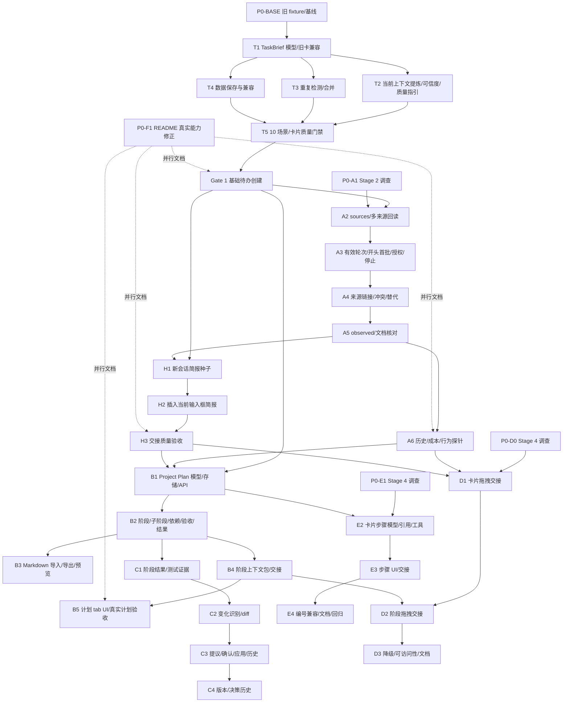

# Todo Assistant 后续开发待办计划（基于当前仓库实际代码）

> **仓库**：`zangoose335/dsh-todo-assistant`，基线提交 `be8ebf4`（`docs: fix inbox wording and note multiple markers per reply`）。
> **本次范围**：基于现有 `docs/PLAN.md` 修订开发计划；本次仅修改本文件，未修改源码、测试、README、`docs/DESIGN.md`，未提交，未实现任何功能。
> **基线验证**：已运行 `node scripts/verify-domain.mjs`，结果 **184/184**；`git status` 干净。`docs/DESIGN.md:621-631` 记录的 109/145/181 项已过时，需在文档任务里更正。
> **核心结论**：当前实现是“卡片式旁支任务工作台 + 单范围（origin.seqRange）原文回读”，卡片已有 `core`/`mustRead`/`park`，但**没有结构化任务简报，也没有卡片质量门禁**；Project Plan、计划持续维护、Markdown 导入、拖拽插入、卡片步骤编号均未实现。本次修订把“从当前上下文提炼必要情报并创建高质量待办”定为 Stage 1 / MVP；历史补全、交接、Project Plan 与导入均为后续阶段。README 的部分措辞需要先修正。

---

## 0. 产品定位与本次修订的硬约束

### 0.1 核心产品定位

DSH Todo Assistant 的核心价值不是保存更多历史信息，也不是给待办附加更多文档链接。它的核心价值是：**从当前工作上下文中提炼出必要情报，形成一份精简、可靠、能够指导开发者继续工作的任务简报**，从而降低任务切换成本，避免重复调查。

把待办卡片理解为一份交接给开发者的任务简报。假设领导向开发者布置任务，通常需要直接说明：

- 要解决什么问题，或者要实现什么需求；
- 为什么需要解决这个问题；
- 已经确认的关键事实和决定；
- 不能违反的约束；
- 已知的技术线索；
- 开始执行时应该采取什么行动；
- 哪些重要问题尚未确认。

只要这些信息足够，开发者就应该能够开始工作，而不必先重新阅读一大批历史对话或参考文档。

必须区分两件事：

- **主体**：提炼并保存必要情报——这是插件的核心职责。
- **辅助**：在信息不足时，通过历史记录、文档或其他来源补充信息——这是必要时使用的辅助能力。

不能把辅助能力当作主体的替代品。

### 0.2 来源指针是兜底，不是主体

现有计划中的 `sources`、`EvidenceRef`、`basis`、`mustRead`、历史消息范围和文件路径等设计可以保留，但定位必须调整：

1. 优先保存精简后的任务情报，而不是只保存原始信息的位置。
2. 来源指针用于必要时追溯、核实和补充信息。
3. 不能因为保存了文档路径，就认为任务背景已经记录充分。
4. 不能把未经核实的文档路径描述为已经阅读、已经验证的资料。
5. 已经确认的任务信息应尽可能直接写入卡片，避免开发者重新调查。
6. 不要为了让卡片显得完整而机械地填满所有字段。
7. 对简单任务保持轻量；只记录完成任务所必需的信息。

**不合格示例**：“修复语言列表删除异常。参考 LanguageListView.swift 和之前的对话。”——只有标题和路径，没有任务情报。

**合格示例**：直接说明“最后一种语言不允许删除；当前缺少操作反馈；需要增加左右抖动；无需让列表项跟随手指移动；下一步检查删除按钮的启用条件和反馈调用”。文件路径只是辅助线索。映射到 TaskBrief：`goal`=修复语言列表删除异常；`confirmed`=当前缺少操作反馈；`constraints`=最后一种语言不允许删除、无需列表项跟随手指移动；`nextAction`=检查删除按钮启用条件和反馈调用；`leads`=LanguageListView.swift（是否已读需标 verified/unknown）。

### 0.3 明确区分信息的可信程度

卡片与信息提炼必须保留以下区分：

- 开发者明确提出的需求；
- 开发者已经确认的决定；
- 有依据支持的已验证事实；
- AI 根据现有信息作出的推断；
- 尚未确认的信息；
- 已经被后续决定取代的旧方案。

不能把 AI 推断写成开发者已经确认的决定。如果某个细节尚未确认、但不影响当前任务简报的可靠性，可以保留为未知，不必立刻展开调查；如果缺失信息可能影响实现方向、正确性或安全性，应明确指出问题，必要时向开发者确认。

### 0.4 MVP 顺序

1. **Stage 1：基础待办创建（MVP）**——任务简报、信息提炼、可信度区分、卡片质量、重复检测、数据保存与兼容性。必须先做好，且**不依赖**完整历史检索、Project Plan、Markdown 导入、拖拽或卡片步骤。
2. **Stage 2：必要的上下文补全**——历史读取、授权机制、有效轮次识别、信息冲突处理、来源追溯、累计读取成本。
3. **Stage 3：任务交接质量**——新会话/输入框使用任务简报，参考资料核对，降低恢复任务成本。
4. **Stage 4：扩展能力**——Project Plan、Markdown 导入导出、阶段与依赖管理、持续计划维护、卡片步骤、拖拽交接。

后续功能设计可以保留，但不得争夺 Stage 1 的开发资源，也不得让后续依赖反过来决定 Stage 1 的顺序。

### 0.5 其他硬约束

- **Token 效率是硬性约束**：目标是少而可靠，不是多而完整；不重复读取、重复摘要、整段注入。
- **当前可见上下文优先**；历史检索不是创建待办的必经步骤。
- 如果确实需要回读，较早的有效轮次可以作为默认第一批候选；默认批次**最多 5 个有效轮次**，不是必须读 5 轮，也不是目标。
- **授权独立于创建待办**：`#db`/`#memo` 只授权记录；额外历史需明确授权；不得把 `approved:true` 当授权证明。
- **冲突与时效**：证据优先，时间距离不能单独决定可信度；无法判断且影响正确性时向开发者确认；不检索整个会话。
- **停止条件**：必要情报足够就停止；剩余只是背景、无关讨论或不会影响执行时停止。
- **来源指针是精准追溯的工具**，不是要求后续重新阅读大量资料的借口。
- **不能为了省 Token 删除**未来执行所必需的关键约束、验收标准或验证信息。
- 项目计划/阶段/交接必须复用已有任务简报和决定，不每次重新分析完整历史。

---

## 1. 当前状态调查

### 1.1 已经实现的能力（有代码证据）

| 能力 | 状态 | 代码位置 / 说明 |
|---|---|---|
| 卡片 CRUD、列表、详情、状态、工作区/收件箱、视图、筛选持久化 | 已实现 | `domain.js:96-167`（schema）、`api.js:60-273`（store）、`api.js:283-365`（endpoints）、`host.js:54-223`（装配）；`client.js:1135-2032`（右栏面板） |
| `todo_add` 捕获表单、字段上限、`origin`、git 坐标、`park`/`mustRead`/`symbols` | 已实现 | `tool.js:169-352`、`domain.js:370-495`、`tool.js:141-167`（origin）、`git.js:132-146` |
| `todo_read` 卡片/notes/park 指针、`todo_note` 追加、`todo_list` 索引、`todo_status` | 已实现 | `tool.js:361-487`、`tool.js:495-548`、`tool.js:556-610`、`tool.js:708-752` |
| `todo_recall` 两段式（目录/正文） | 已实现，**仅 origin 范围** | `tool.js:622-695`、`recall.js:91-178`；数据来自 `ctx.sessionQuery.readSession()`（`host.js:165-172`） |
| 开发者原话 `request`、`#DB/#MEMO` 标记、标记队列 | 已实现 | `tool.js:61-107`、`marker.js:22-122`、`host.js:96-107`、`host.js:131-147` |
| 路径相关性提醒、侧栏“相关”角标 | 已实现，仅文件路径 | `detect.js:14-26`、`detect.js:159-233`、`host.js:88-128`、`api.js:286-301` |
| 近似重复检测 | 已实现 | `dedupe.js:69-90`、`tool.js:292-311` |
| 短编号 `x.y`、按根会话分组、旧记录迁移 | 已实现 | `domain.js:176-180`、`api.js:73-146`、`api.js:100-120` |
| 新会话交接、插入当前会话 | 已实现，插入仅一句提示 | `client.js:1228-1269`（buildSeed）、`client.js:1281-1323`（startSessionFor）、`client.js:1326-1344`（insertIntoCurrent） |
| 工作区通用规则（新会话种子拼接） | 已实现 | `api.js:205-229`、`client.js:1300-1318`、`client.js:1359-1400` |
| 右栏 tab、捕获面板、`#` 引用框、`#db` 补全 | 已实现 | `client.js:719-968`、`client.js:971-1132`、`client.js:2034-2107` |
| 存储域 `todo_assistant`（`todos`/`rules`） | 已实现 | `domain.js:22-24`、`domain.js:163-167`、`host.js:54-62`；现有本地存储为 version 1 |

### 1.2 已实现但存在范围限制的能力

| 能力 | 限制 | 证据 |
|---|---|---|
| 原文回读范围 | 只读 `origin.seqRange`：`todo_add` 存的是**当前轮**（`turn/start` 到调用前），不能读创建卡片之前的轮次，也不能关联多个历史片段 | `tool.js:141-167`、`recall.js:91-105`、`tool.js:622-695` |
| 回读授权 | 仅靠工具描述里的“先问开发者”硬规则；没有工具级审批门禁，也没有把“开发者同意”与“具体读取范围”绑定 | `tool.js:23-30`、`tool.js:622-630`；`docs/DESIGN.md:388-400` 明确决定不加机械审批。DSH 现有 `tools/pre-execute` 的 `ask` + `ApprovalService` 可复用，但本插件未接入（见 1.5/2.3.4） |
| 默认检索范围 | 没有“对话开头五个有效轮次”的第一批概念；`todo_recall` 无参时返回的是 origin 范围内的逐条消息目录 | `recall.js:114-141`、`docs/DESIGN.md:320-334` |
| 当前可见上下文优先 | `todo_add` 的描述要求“只用仍然可见的内容，先问再回读”，但没有 host 侧流程约束，也没有“信息缺口 → 是否检索”的结构化判断 | `tool.js:23-30`；当前没有 gap/停止条件的工具参数或测试 |
| 有效轮次定义 | 没有把“有效对话轮次”与消息数、事件数、工具调用数区分；没有开头首批窗口 | `recall.js:98-102` 只跟踪 `turn/start`；无“人类发言/合成注入”的过滤 |
| Token 效率度量 | 没有累计读取消息/事件/字符、index vs body、批次数、重复读取、简报是否足够避免复研的指标；只有单次正文/总量字符上限 | `recall.js:20-25`（2000/12000 字符上限）；无累计代理指标或测试 |
| 事实来源 | `mustRead[].where` / `park[].where` 各只有一个指针；没有 `basis`（已确认/已决策/推断/未确认），没有多来源 | `domain.js:52-69`、`domain.js:247-261`；现有卡中 `mustRead.where.file` 有使用，`seqRange` 很少 |
| 任务简报 | 只有 `core`/`mustRead`/`park`，没有结构化 `brief`（goal/why/confirmed/constraints/leads/next/openQuestions），也没有卡片质量门禁；可能出现“只有标题+路径”的卡片 | `domain.js:144-154`、`tool.js:169-280`；现有卡有文件指针，但没有 brief 字段 |
| 参考文档路径 | 只保存模型主动填的 `touchedFiles` / `mustRead[].where.file` / `symbols[].file`；没有 host 侧“本轮实际读过”校验，也没有“已读/仅提及/未核实”区分 | `domain.js:452-465`、`domain.js:438-450`；真实卡片有文件路径，但无 provenance |
| 新会话交接 | `buildSeed` 只带旧 `core`/`mustRead`/`park`/L1；没有 brief-first，也没有“先核对参考文档是否仍成立”的指令 | `client.js:1228-1269`、`client.js:135`（`seed.hint`） |
| 插入当前会话 | 只插入一句“现在切到待办 #id…”；不是完整上下文包 | `client.js:1326-1344`、`client.js:169` |
| 编号 | 只有 `x.y`；`findRef` 不解析 `x.y-N`；没有卡片内部步骤 | `api.js:100-120`、`domain.js:176-180` |
| 相关性检测 | 只有“本轮触及文件”的精确匹配/共享目录前缀；符号与 commit 两路已明确不做 | `detect.js:159-181`、`docs/DESIGN.md:444-473` |
| 子会话归属 | `rootSessionId` 只在部分较新的卡上存在，旧卡没有 | `domain.js:79-88`、`api.js:73-90` |

### 1.3 未实现/后续能力（Gate 1 后）

> T（TaskBrief、质量门禁、当前上下文提炼、可信度、去重、创建验收）与 README 修正已在 Gate 1 完成，不再列在这里。

- H：任务交接质量（简报优先的新会话/输入框/文档核对，Stage 3）。
- A2（Stage 2）：卡片关联任意历史轮次、多个历史来源。
- A3（Stage 2）：当前可见上下文优先、按信息缺口决定是否检索、对话开头五个有效轮次的第一批、检索停止条件、DSH 工具审批门禁。
- A3b（Stage 2）：Token 效率的可执行约束与代理指标（不必要读取、重复处理、读取消息/事件数、批次数、信息充分性、关键约束遗漏）。
- A4（Stage 2）：来源链接、历史冲突、被替代判断；basis 核心在 T2。
- A5（Stage 2）：参考文档路径的“实际读过/提及/未核实”区分，以及交接时的核对指引。
- B（Stage 4）：Project Plan 容器、阶段/子阶段/依赖/验收/当前阶段/阶段上下文包。
- C（Stage 4）：阶段执行结果、计划变化识别、修改确认、版本与决策历史。
- D（Stage 4）：从右侧栏拖拽卡片到输入框插入上下文。
- E（Stage 4）：卡片内部步骤与 `x.y-N` 编号。

### 1.4 需要进一步调查/验证的 DSH API（不要假设已可用）

> **Stage 1 只依赖第 4 项**（新增 optional 字段/表的兼容性验证）以及 `P0-BASE`。第 1/7/8/9/10/11 项属于 Stage 2（历史/授权/成本）；第 2 项属于 Stage 4（拖拽）；第 3/5 项属于 Stage 3/4（交接/客户端共享）；第 6 项可服务 Stage 2/3（文档核对）。不要借 Stage 1 调查启动后续功能的设计或实现。

1. **`sessionQuery.readSession()` 的运行时行为**：live/persisted、压缩后原始日志、`turn/start` 边界、`seq` 连续性、大日志性能。类型和真实日志已确认，但仍需一次运行时探针。
2. **拖放可行性**：Lexical 编辑器原生 `text/plain` drop 是否可靠；`conversation.input.overlay` 内自绘 drop 层能否稳定接收 `dragover/drop`；`inputActions.insertText` 在输入框未聚焦时的行为。
3. **右栏 slot props 的运行时确认**：`sidebar.right.pane.tab` 的 `inputActions`、`useWorkspaces`、`sessionId` 是否在所有布局（docked/floating）都存在。
4. **新增 optional 字段/表但不升 domain version 的可行性**：single layout 对缺失表返回空表；需要用一个 version-1 旧文件做 fixture 实测。
5. **客户端共享代码方式**：client bundle 的 `require` 只解析包名，不能相对导入本地 `handoff.js`；若要统一卡片/阶段交接文本，需要 host endpoint 或在 `client.js` 内内联。
6. **文档存在性检查**：host 侧是否有可用的 `fs` 服务；没有就只能靠 AI 用 read 工具核对，不能承诺自动检查。
7. **DSH 工具审批可用性**：`tools/pre-execute` 的 `ask` 决策 + `ApprovalService` 在 web profile 是否已组合；`ctx.get('approval')` 是否存在；插件注册 pre-execute 监听器是否影响其他工具；审批提示是否覆盖任意插件工具。类型和示例已确认，仍需运行时验证。
8. **“有效对话轮次”的稳定性**：`turn/start` + 人类 `user/message` 的过滤在 live/persisted/compacted 日志中是否可靠；`turn/end` 是否总能配对；如果 `turn/start` 缺失或日志被裁剪，是否只能退化为“消息区间”并标注不确定。
9. **审批与读取范围的绑定**：DSH 审批是 per-call `allowed-once`；能否在 `displayReason` 中准确展示准备读取的轮次/范围；一次批准是否只覆盖该次调用；失败/拒绝后的工具结果如何呈现；纯结构性元数据与含首行/正文片段的索引边界如何区分。
10. **Token 实际用量**：`tokenMeter`/`TokenUsage` 能否拿到每次 `todo_recall` 的实际 token；若不能，只能使用消息数/事件数/批次数/字符数等代理指标，不能编造精确 token 数据。
11. **对话开头首批的可见性**：如何判断开头 5 个有效轮次是否已被压缩/隐藏，或仍在当前模型可见 surface 中；如果没有可靠 API，必须让 AI 先检查可见上下文，不重复读取，并把“无法判断可见性”标记为限制。

### 1.5 本次已确认、可作为设计依据的 DSH API 事实

| 事实 | 依据 |
|---|---|
| `readSession(sessionId)` 返回 `{ session, inheritedEventCount, events }`，`events` 是完整原始日志（含压缩前事件），每条有 `seq/type/data` | DSH `dsh-session-query/lib/index.js:1079-1087`；`docs/DESIGN.md:621` 的 M6 说明 |
| `turn/start` 事件带 `data.turn`；`assistant/message`/`tool/result`/`developer/message` 带 `turn`；`user/message` **不带** `turn`，必须靠 `turn/start` 跟踪 | DSH `dsh-session/lib/types/types.d.ts:255-360`；现有日志样本已核对 |
| 有效轮次可基于 `turn/start` 括号 + `user/message.source.kind === 'user'` + 非空文本；`assistant/message`/`tool/call`/`tool/result` 属于同一轮，不单独计数 | DSH 类型 + 真实日志；persisted/compacted 下的稳定性仍需运行时探针（见 1.4） |
| DSH 工具级审批：`tools/pre-execute` 可返回 `{kind:'ask'}`；`dsh-tools` 通过 `ctx.get('approval')` 解析，只有 `allowed-once` 才执行；无审批服务时按 deny 处理 | DSH `dsh-tools/lib/types/index.d.ts:47,439-460,817-825` |
| `ApprovalService.request()` 需要打开的 turn，结果封闭为 `allowed-once/rejected/cancelled/unavailable`，并写 `approval/asked`/`approval/decided` 审计事件 | DSH `dsh-user-approval/lib/types/index.d.ts:105-155`；`dsh-experimental-auto-review/lib/index.js:427-445` 的 `ask` 用法 |
| 每次 `assistant/message` 可带 `usage`（TokenUsage）；`tokenMeter.estimateMessage` 只能估算，不能保证等于实际计费；不能用估算冒充精确 token | DSH `dsh-session/lib/types/types.d.ts:330-360`；`recall.js` 的 estimateTokens |
| `sidebar.right.pane.tab` 的标准 props 包含 `inputActions`、`useWorkspaces`、`sessionId`、`useInput` | DSH `dsh-cordis-client-runner/lib/client.js:5113-5145` |
| `conversation.input.overlay` 的标准 props 包含 `inputActions`、`useInput`、`sessionId`，且渲染在 composer card 内 | DSH 同上 `:3151-3199`；`dsh-client-ui-conversation/lib/client.js:17452` |
| 输入框是 Lexical contenteditable；Lexical 注册 `DROP_COMMAND`，对 `text/plain` 调用 `insertRawText`；附件插件只拦截 `Files` 类型 | DSH `dsh-client-ui-conversation/lib/client.js:16538-16625`、`:12190-12193`；`dsh-client-ui-attachment/lib/client.js:540-590` |
| `InputActions` 提供 `captureInsertion()`、`insertText(text, span)`、`setDraft(text)`、`submit()`；`insertText` 是 revision-guarded | DSH `dsh-client-ui-conversation/lib/types/client/contract/input.d.ts:206-226` |
| 新会话交接用 `remote.session.create({workspaceId|cwd})` + `prompt({sessionId, requestId, mode:'queue', content:[{type:'text'}]})` | 现有 `client.js:1307-1319`，M5 已验证 |
| client bundle 的 `require` 只解析包 specifier，不能相对导入本地模块 | DSH `dsh-client-modules/lib/index.js:80-100`、`:456-472` |
| JSON backend 的 `single` layout **严格比较** `unit.version`；`compatibleVersions` 只对 `per-record` 生效 | DSH `dsh-storage-json/lib/index.js:91-118`、`:344-360`；因此**当前阶段不能随意把 `DOMAIN_VERSION` 从 1 升到 2**；未来不兼容变更需先设计迁移 |
| 新增表在 single layout 中缺失时读为空表；新增 optional 字段可被 zod 接受 | DSH `dsh-storage-json/lib/index.js:109-117`；`domain.js:96-154` 现有默认值写法 |

### 1.6 现有数据与兼容性事实

- 现有本地存储：`unit.version = 1`，表 `todos`/`rules`。
- 部分较新卡有 `request` 和 `origin.rootSessionId`；旧卡没有。
- 现有卡使用了 `mustRead[].where.file`，几乎不使用 `mustRead[].where.seqRange`；说明现有模型实际只用了文件指针。
- 没有 `steps`、没有项目/阶段字段、没有 `sources`。
- `scripts/verify-domain.mjs:103` 断言 `declared tables = ['todos','rules']`；新增表后必须同步修改。
- 结论：**当前阶段优先采用已验证的低风险方式：新增 optional 字段/新增表，`DOMAIN_VERSION` 保持 1，并用旧 fixture 验证**。这不是“永远不能升版本”：未来若需要不兼容变更，应先设计并验证迁移/备份/降级方案，再决定是否升版本；不能在没有迁移方案时贸然升级。
- 当前没有 `brief` 字段；真实卡片可能“只有路径没有简报”，需要用 Stage 1 质量门禁暴露并纠正。
- 当前没有可用的 `todo_recall` Token 指标；`docs/DESIGN.md:388-400` 记录当时持久化日志中 `todo_recall` 调用为 0（需按当前数据重新核对，不能当作永久事实）。计划中的 Token 指标只能使用代理指标，除非后续实测。
- 现有卡无法用来验证“创建时是否过度检索”；需要行为探针（见 A6）。

---

## 2. 关键设计决策（先定下来，避免后续返工）

### 2.1 三类对象必须分开

| 对象 | 例子 | 存储 | 编号 | 依赖/验收 | 交接方式 |
|---|---|---|---|---|---|
| 普通旁支卡片 | `#3.2` | `todos` | `major.minor`，创建时持久化 | 无 | 新会话种子 / 插入当前输入框 / 拖拽 |
| 卡片内部步骤 | `#3.2-1` | `todos[].steps` | 展示序号 `x.y-N`；内部稳定 `sid` | 无 | 随卡片种子带出；不单独交接 |
| 项目计划 | `pj_x7k2` | `projects` | 项目 id + 名称 | 项目级目标/决策/风险 | 阶段上下文包 |
| 项目阶段 | `Phase 4a` | `projects.phases[]` | 展示 `number`（可编辑）+ 稳定 `pid` | 有 deps/acceptance/result | 阶段上下文包 / 拖拽 |

**明确不允许**：把项目阶段塞进普通卡片表当作独立卡片；把卡片步骤当作项目阶段；用 `x.y-N` 给项目阶段编号。

普通卡片的主体是 TaskBrief（2.2.1）；`sources`/`steps`/项目阶段都是扩展，不是普通卡片必须先具备的字段。

### 2.2 任务简报优先，`sources`/provenance 兜底

#### 2.2.1 任务简报（TaskBrief）是卡片主体

待办卡片首先是一份任务简报，而不是来源清单。新增 optional `brief` 字段（旧字段保留兼容）：

```ts
type BriefBasis =
  | 'requirement'   // 开发者明确提出的需求
  | 'decided'       // 开发者已经确认的决定
  | 'verified'      // 有依据支持的已验证事实
  | 'inferred'      // AI 推断
  | 'unknown'       // 尚未确认
  | 'superseded'    // 已被后续决定取代的旧方案

interface BriefItem {
  text: string
  basis: BriefBasis
  sourceIds?: string[]          // 可选：指向 SourceRef.sid，用于追溯
  impact?: 'blocking' | 'non-blocking'
}

interface TaskBrief {
  goal: string                  // 要解决什么问题/实现什么需求
  why?: string                  // 为什么需要
  confirmed?: BriefItem[]       // 已确认事实/决定；默认 []，复杂任务应填
  constraints?: BriefItem[]     // 不能违反的约束
  leads?: BriefItem[]           // 已知技术线索（文件/符号/文档），辅助而非主体
  nextAction: string            // 开始执行时应该采取什么行动
  openQuestions?: BriefItem[]   // 尚未确认且可能影响执行的问题
}
```

规则：

- **简单任务保持轻量**：`goal + nextAction` 即可；复杂任务再补 `confirmed/constraints/leads/openQuestions`。不要求每张卡都填满，也不允许机械凑字段。现有 `todo_add` 的 `title`/`kind`/`nextStep`/`touchedFiles`/`mustRead` 参数保留；简单任务允许 `touchedFiles`/`mustRead` 为空，不要求为了填字段去读历史。
- **简报优先**：`todo_read`/UI 先展示 `brief`，再展示 `mustRead`/`park`/`sources`。来源指针只在需要追溯/核实时展开。
- **旧卡兼容**：`brief` 缺省时，从 `core.symptom`/`core.intent`/`core.cause`/`core.nextStep`/`mustRead`/`park` 投影出只读 brief；不批量改写旧记录。
- **旧 `basis` 映射**：`confirmed → verified`、`decided → decided`、`inferred → inferred`、`unverified → unknown`；`superseded` 只用于历史/被替代信息，不进入当前约束。
- **来源不是资格**：没有 `sources` 也可以有合格简报（来自当前可见上下文）；但 `inferred`/`unknown` 必须标记。**只有来源指针、没有简报的卡片必须判定为不合格**。
- **建议上限**（T1 定稿）：`goal` ≤ 200 字、`why` ≤ 200、`nextAction` ≤ 280、`confirmed` ≤ 6 条/每条 ≤ 200、`constraints` ≤ 4、`leads` ≤ 4、`openQuestions` ≤ 4、总字符 ≤ 1200（软上限）。复杂任务超出时提示拆分为多个待办或追加 note，不静默截断关键约束。
- **不把未核实路径写成事实**：`leads` 中的文件/文档路径可以标 `verified`（真的读过）或 `unknown/inferred`（仅提及/推测）；`sources` 是兜底追溯，不是“已阅读”的证明。

#### 2.2.2 `sources` 与 provenance（兜底）

在 `TodoItem`（以及 `ProjectPlan`/`Phase`）上新增：

```ts
interface SourceRef {
  sid: string                    // "src_x7k2"，稳定，不重排
  kind: 'session' | 'file'
  label: string                  // 这是什么/用途
  purpose: 'capture' | 'recalled' | 'doc' | 'code' | 'decision' | 'rejected' | 'risk'
  where: {
    sessionId?: string
    seqRange?: [number, number]
    file?: string
    offset?: number
  }
  turnRange?: [number, number]
  origin: 'observed' | 'stated' | 'inferred'  // 指针怎么来的
  verified: boolean              // 内容是否真的被读过/核对过
  at: number
  addedBy?: string
}
```

在 `mustRead` / `park` / `notes` 上新增：

```ts
basis?: 'confirmed' | 'decided' | 'inferred' | 'unverified'
sourceIds?: string[]             // 指向 SourceRef.sid
role?: 'fact' | 'decision' | 'rejected' | 'risk' | 'doc' | 'code'
```

> 兼容字段仍用旧 `basis` 枚举（`confirmed/decided/inferred/unverified`）；投影到 TaskBrief 时按 2.2.1 映射为 `verified/decided/inferred/unknown`。新 brief 直接用 `BriefBasis`，不要两套混写。

规则：

- **旧卡兼容**：`sources` 缺省为 `[]`；投影时把 `origin` 合成为隐式 `s0`，把 `mustRead/park/touchedFiles` 里的文件合成为 `origin:'stated', verified:false` 的文件来源。**不写回存储**，除非后续真的读过/刷新。
- **实际读过才算 verified**：`todo_recall` 正文读取成功后，才把对应 session source 标记/追加为 `origin:'observed', verified:true`；模型在 `todo_add` 里声明的历史轮次默认 `origin:'stated', verified:false`。
- **文件路径不自动全量吸收**：host 从当前轮 `tool/call` 收集 observed 文件集合，但**只用于校验模型主动填的路径**；不把本轮所有主任务文件自动塞进卡片，避免污染。模型填的路径若在 observed 集合中 → `observed/verified`；否则 → `stated/unverified`。
- **推断必须标记**：`basis:'inferred'` 的条目在 `todo_read`/UI 中显示 `[推断]`；`basis:'confirmed'` 但没有任何 `sourceIds`/`where` 时给 warning，不静默当事实。
- **已排除方案**：卡片的 `park` 条目用 `role:'rejected'`、`why` 写原因、`basis:'decided'`；项目阶段用 `Phase.decisions` 的 `status:'rejected'` + `reason`。
- **`touchedFiles` 保留原语义**：用于提醒/去重；provenance 放 `sources`，不改变现有检测逻辑。
- **来源只存指针，不存正文**：`SourceRef` 是定位线索；正文只在 DSH 审批后按最小范围读取，读完也不回写卡片正文。
- **冲突/时效**：来源可能过期或与当前冲突，按 2.3.6 处理；`verified` 只表示“读过/核对过”，不表示“永久有效”。

### 2.3 历史回读：当前可见优先、按需检索、有效轮次与 DSH 审批（Stage 2）

#### 2.3.1 基本顺序：先看当前可见上下文，再判断是否需要历史

创建待办时的顺序固定为：

1. **整理当前可见上下文**（不调用历史工具）：任务目标/背景、限制条件、开发者明确决定、已验证事实、相关文件/文档路径、下一步、未解决问题。只提取与本待办及未来恢复有关的内容。
2. **做信息缺口判断**：完成待办所必需的信息还缺什么？缺口是否可能存在于历史中？是否必须在创建时取得？能否只保存文件/文档路径或来源指针，等未来恢复时再核实？
3. 如果当前信息足够，或只缺可由路径/下一步在未来核实的信息：**直接创建待办，不检索历史**。
4. 只有在缺口会影响待办正确性、且可能存在于历史中时，才进入历史检索；先说明已掌握什么、缺什么、为什么历史可能有帮助、准备读取的范围，再走 2.3.4 的 DSH 审批。检索有两种时点：**建卡前必须取得** → 用 `todo_recall` 的 `session:current` 目标（不绑定卡片）；**建卡后再补** → 用卡片 id 目标。
5. 不得先读历史再找理由；不得因为“默认批次/完整性”而读取；不得重复读取当前已经可见的内容。

> **Stage 1 只执行步骤 1-3**（当前可见/缺口判断/直接建卡）；步骤 4-5 的历史检索属于 Stage 2。Stage 1 遇到缺口时标 `openQuestions` 或询问，不调用 `todo_recall`。

#### 2.3.2 “有效对话轮次”的定义（best-effort，待运行时确认）

以 DSH 的 `turn/start` .. `turn/end` 为一个轮次括号；在一个轮次内：

- **有效轮次** = 该括号内至少有一条**人类开发者**发出的 `user/message`（`data.source.kind === 'user'`，非空文本）。`assistant/message`、`tool/call`、`tool/result`、`step/*` 都属于同一轮，**不单独计数**。
- 合成注入的 `user/message`（file-change、runtime context、skill、goal continuation 等，`source.kind !== 'user'`）不计入“人类发言”；只有合成消息、只有工具调用/结果、空消息、被取消且没有人类发言的轮次，不是有效轮次。
- 同一轮里开发者说了多次，仍算一个有效轮次；AI 回复不是独立轮次。开发者发言后 AI 回复被中断的轮次仍算有效（开发者的话可能包含约束），但在索引中标记 `humanOnly`/`interrupted`，不假装有完整回复。
- **当前正在创建待办的轮次排除**：按 `turn` 号 / capture point 排除当前轮，避免把“正在说的话”当成历史。
- 会话开头不足 5 个有效轮次时，取实际存在的全部；不得补造。
- 没有 `origin.sessionId` 的手工卡/无会话卡：first batch 不可用，返回 `unavailable`，不得用其他会话猜测。
- 子会话：按 `origin.sessionId` 计算；`rootSessionId` 只用于分组，不自动混入根会话历史。跨会话读取必须显式指定来源并单独授权。
- 压缩后：原始日志（`sessionQuery.readSession`）仍可能保留 `turn/start` 和消息；但 persisted/compacted 场景需运行时探针。如果无法可靠恢复轮次边界，**不要伪造精确轮次**，改用“消息序号区间”作为较粗定位，并在结果中标注 `boundary: 'approximate'`。

> 这是基于当前 DSH 事件结构的 best-effort 定义，不是 DSH 已承诺的稳定“有效轮次 API”。运行时不满足时按本节的降级方案处理。

#### 2.3.3 第一批检索范围：对话开头五个有效轮次，但不是必选项

- **第一批默认范围** = 对话开头最早的 5 个有效轮次（按 `turn` 升序，排除当前轮），**不是**“创建前最近 5 轮”，也**不是**“最近 5 条消息/事件/工具调用”。
- 第一批按**时间正序**返回，便于还原任务目标、背景、初始限制；不是“从近到远”。
- 第一批**不是必选操作**：
  - 当前可见上下文已经足够 → 不读。
  - 当前可见上下文已经包含相关早期内容 → 不重复读。
  - 缺口是最近才发生的（例如刚改过的决定）→ 可以直接定向读取相关轮次，不必为了“检查开头”而读第一批。
  - 早期内容已被压缩/隐藏且确实需要 → 走审批后读取。
- **不自动触发读取的理由**：单纯希望卡片更完整；仅仅存在可读历史；某个来源指针还没打开；计划规定了默认批次；只为补齐非必要字段。
- 第一批读取后，只提取与待办相关、能补足缺口的内容；**5 轮不是成功指标，不是终点**。
- 如果第一批已足够 → 立即停止。
- 如果仍有重要缺口 → 说明具体缺什么，再判断是否值得扩大；扩大范围必须重新走审批（2.3.4），不得自动连续读。
- 如果剩余信息只是背景/无关讨论/不影响执行的细节 → 停止，不读。
- **相关性由“缺口 + 待办目标 + 约束”判断**，不由关键词命中、相似句子或文件路径单独决定；关键词/路径只是定位线索。

#### 2.3.4 授权边界：复用 DSH 工具审批，不用模型自填布尔值

四类操作及其边界：

| 级别 | 操作 | 授权边界 |
|---|---|---|
| L1 | 查看当前已经可见的上下文 | 不需要工具调用，不需要授权 |
| L2 | 查看历史目录/轮次索引/摘要/元数据 | 属于历史访问；通过 DSH 工具审批提示（轻量提示，显示“仅索引”），`allowed-once` 才执行；不得只靠模型说“已同意” |
| L3 | 读取被压缩/隐藏的历史正文 | 必须 DSH 审批；提示必须显示目标轮次/序号范围、读取目的、预计规模；`allowed-once` 才执行 |
| L4 | 扩大到第一批之外的更多历史 | 必须重新 DSH 审批；提示必须说明上一批已获得什么、还缺什么、为什么需要更大范围 |

> **索引不等于纯元数据**：如果目录/轮次索引/摘要包含消息正文片段、首行内容或其他实质性对话内容，应按 L3 内容读取处理，不得伪装成纯元数据操作；只有无正文的计数、轮次号、范围、字节数等才算纯元数据。该边界需在 P0-A1 用实际 DSH 索引验证。

实现方向（优先复用 DSH 已有能力）：

1. 在 `host.js` 现有的 `ctx.inject(['tools'], ...)` 中注册 `toolCtx.on('tools/pre-execute', ...)`（或实测确认顶层 `ctx.on` 可用）；仅拦截 `todo_recall`（以及未来的 `todo_plan_recall`）。
2. 从 `exec.arguments` 读取 `target`/`mode`/`gap`/`reason`；对**任何** `todo_recall` 调用返回 `ask`：`mode:'index'` 用轻量提示（仅索引），`mode:'body'` 或目标超出第一批/已声明范围用完整提示（范围/目的/规模）。示例：
   ```js
   { kind: 'ask', reason: auditedReason, displayReason: { en, zh } }
   ```
   `dsh-tools` 会通过 `ctx.get('approval')` 调 `ApprovalService.request()`；只有 `allowed-once` 才执行；`rejected/cancelled/unavailable` 都拒绝。审批会写 `approval/asked` / `approval/decided` 到会话日志。
   - 建卡前 `session:current`：gate 从 `exec.agent.session` 取当前会话/当前轮，提示显示会话与目标轮次范围；无 agent/无 open turn → deny。
3. 如果 `ctx.get('approval')` 不存在（headless/未组合）：**fail closed**，历史读取不可用；运行时按 deny 处理并给出明确原因，工具不会执行，而不是放行。
4. `todo_recall` **不再接受 `approved: true` 作为授权**。`approved` 若保留只能作为“我已向开发者说明”的提示，不参与权限判断；更推荐直接删除该参数，改为 `gap`/`reason` 供审批提示使用。
5. 审批是 **per-call `allowed-once`**；一次批准只覆盖该次调用的范围，不产生持久授权。不要把它描述成“永久允许读取历史”。但一次工具调用可以读取**已批准的完整最小连续范围**，不要拆成每消息/每文件多次审批；扩大范围或新调用再审批。若未来 DSH 提供范围/批次批准，优先使用，避免不必要的反复授权。
6. 模型仍必须在对话里先说明“已掌握什么、缺什么、为什么历史有用、准备读什么范围”；DSH 审批提示是第二道、权威的门禁。若模型没提供 `gap`/`reason`，pre-execute 直接 deny 并给出纠正信息。
7. 标记 `#DB/#MEMO` 只授权记录；必须在 marker 注入文本、`todo_add`/`todo_recall` 描述、README 三处一致。
8. 如果未来 DSH 提供更细的“批批准/范围批准”接口，再替换 per-call 提示；不要自建第二套 token 机制。

> 这是对 `docs/DESIGN.md:388-400` “只靠工具描述”的修订：原决定在“没有可靠审批接口”时是合理的；现在 DSH 已提供 `tools/pre-execute` + `ApprovalService`，应优先复用。若运行时验证发现该组合不可用，则退回“描述硬规则 + fail closed + 明确限制”，不得把模型自填的 `approved` 说成权限控制。

#### 2.3.5 检索停止条件（每次读取后必须回答）

读完一批（或决定不读）后，逐项回答：

1. 待办目标是否明确？
2. 关键限制条件是否明确？
3. 下一步行动是否明确？
4. 重要决定是否存在尚未解决的冲突？
5. 是否已经保留必要的文件路径或来源指针？
6. 是否补充了会影响正确性的关键信息？
7. 继续检索是否可能改变未来执行方案？

判定：

- 以上关键项已足够 → **立即停止**。
- 剩余只是补充背景、无关讨论、不会影响执行的细节 → **停止**。
- 只有“未解决的信息缺口可能影响任务正确性、执行方案或重要约束” → 才考虑继续，并重新走审批。
- 不允许以“再多读一点更完整”“已经读了 5 轮就继续读”为理由扩大范围。

#### 2.3.6 历史冲突与信息时效性

1. 早期历史与当前可见信息冲突时，不直接把旧信息当当前事实。
2. 优先寻找开发者明确改变方向、撤销旧决定或确认新方案的证据；检查后续讨论、实际代码修改、验证结果是否佐证方向变更。
3. 时间间隔越远越需要谨慎，但时间距离不能单独决定可信度：较早的约束可能仍有效，较新的信息也可能是未确认的猜测。
4. 有可信方向变更证据 → 保留当前有效决定，把旧决定标为“历史/已被替代”，不要写进当前约束。
5. 无法找到可信依据且冲突影响待办正确性 → 向开发者确认；不要为了消除所有不确定性而检索整个会话。
6. 区分：开发者明确确认的决定、有证据支持的事实、AI 推断、尚未确认的信息、已被后续决定替代的旧信息。`basis` 字段按 2.2 记录；不得把推断写成决定。

#### 2.3.7 API 形态、读取统计与错误处理

```text
todo_recall(id?, target?, mode?, gap?, reason?)
```

- `id` 省略时必须 `target:'session:current'`（**建卡前捕获时使用**），以调用方当前会话为来源；结果不绑定/不写入卡片，用于填充随后的 `todo_add`；`id` 与 `session:current` 不能同时出现，否则 `unavailable`。
- `id` 存在：卡片/阶段目标；正文读取成功后才追加/更新该对象的 `sources`。
- `target`：`first-batch` / `turn:N` / `turn:[from,to]` / `source:sid` / `slice:[from,to]` / `origin` / `session:current`；兼容旧版 `slice:[from,to]` 作为 `target` 的别名。
- `mode`：`index`（目录/摘要，不读正文）或 `body`（正文）。`body` 必须走 DSH 审批；`index` 也按 2.3.4 的 L2 处理。
- `gap`/`reason`：模型说明“还缺什么/为什么历史可能有帮助”；pre-execute 用它生成审批提示；缺失则 deny。
- 输出：`shape: 'index'|'body'|'unavailable'`；审批拒绝由 pre-execute/runtime 呈现，不进入工具输出；`batch: {kind:'first'|'targeted', fromTurn, toTurn, effectiveTurns, hasMore, nextRange}`；`stats: {messages, events, estimatedTokens, batch, duplicatesSkipped}`。
- 读取顺序：先 `index` 再 `body`；如果当前可见上下文已经足够，不调用任何 `todo_recall`。
- 正文读取成功后：**不自动追加/更新 source**。按方案 A，只记录两类读取结果：读出了结论 → `todo_note`；明确查过但没找到 → `kind='no-result'` 的 note（文字写问题与范围，`sourceIds` 指向来源）。普通浏览、读完觉得没用的内容不记录；`duplicatesSkipped` 只表示当前 surface 已可见而跳过的数量，不是持久读取账本。建卡前的 session 目标不写卡片；`todo_add` 用 `where` 记录来源。
- 错误处理：逐来源 `available/reason`；失效来源不影响其他来源；无 origin/手工卡 `unavailable`；审批拒绝由 runtime 呈现、工具不执行；不要伪造读取结果。
- 大小上限：沿用单消息 2000 字、整次 12000 字；`index` 限制行数/预览长度；`body` 只读请求的最小连续区间。
- 只支持连续区间读取时：先用 `index` 定位相关轮次/消息，再读最小范围；不要假设 DSH 有语义检索；不要一次性注入整个会话。

#### 2.3.8 与 `todo_add` 的关系

- `todo_add` 不自动调用 `todo_recall`；创建默认只用当前可见上下文。
- 建卡前确有重要缺口：先用 `session:current` 目标走 DSH 审批读取，再把提取到的事实写入 `todo_add`（`where` 记录 sessionId/seqRange），不先建临时卡；建卡后才发现缺口：先用 `todo_add` 建卡，再按卡片 id 回读并 `todo_note` 追加。
- `todo_add` 描述必须写清：先整理可见信息；信息足够就直接建卡；缺关键信息且可能存在于历史时，先说明缺口并询问，获得授权后再用 `todo_recall`。
- `todo_add` 不允许把“为了让卡片更完整”作为读取历史的理由。
- 如果缺的信息可以通过保存文件/文档路径在未来核实，优先保存指针和下一步，不读历史。

### 2.4 Project Plan 模型与写入边界（Stage 4）

新增三张表（domain version 保持 1）：

- `projects`：项目主记录，阶段数组内嵌。
- `plan_proposals`：AI 的修改提议（只写提议，不改计划）。
- `plan_changes`：已应用的变更历史（append-only diff）。

```ts
interface ProjectPlan {
  id: string                    // "pj_x7k2"
  workspace: string
  name: string
  goal: string
  status: 'active' | 'paused' | 'done' | 'dropped'
  currentPhaseId?: string       // pid
  phases: Phase[]
  decisions: EvidenceRef[]      // 项目级关键决策
  risks: EvidenceRef[]
  sources: SourceRef[]
  version: number               // 1 起步，每次应用变更 +1
  createdAt: number
  updatedAt: number
  origin?: { sessionId: string; turn: number; seqRange: [number, number]; at: number }
}

interface Phase {
  pid: string                   // "ph_x7k2"，稳定
  number: string                // 展示号："4" / "4a"；可编辑，不自动重排
  parentPid?: string
  title: string
  goal: string
  status: 'pending' | 'active' | 'blocked' | 'done' | 'dropped' | 'split'
  dependsOn: string[]           // pid[]
  acceptance: EvidenceRef[]
  mustKeep: EvidenceRef[]
  decisions: EvidenceRef[]
  sources: SourceRef[]
  nextStep: string
  notes: Note[]
  result?: PhaseResult
  createdAt: number
  updatedAt: number
}

interface PhaseResult {
  summary: string
  completed: string[]
  files: string[]
  tests: TestEvidence[]
  issues: string[]
  risks: string[]
  decisionsChanged: string[]
  planDelta: string
  sourceIds: string[]
  verification: 'verified' | 'claimed' | 'unverified'
  recordedAt: number
  recordedBySession: string
}

interface TestEvidence {
  command?: string
  status: 'passed' | 'failed' | 'not-run'
  verification: 'tool-result' | 'developer' | 'ai-claim'
  sourceId?: string
  at: number
}
```

写入边界：

- **AI 只能 `todo_plan_propose`**：提议写到 `plan_proposals`，不直接改 `projects`。
- **UI 负责应用/拒绝**：开发者在侧栏看到 diff、原因、受影响阶段，点击“应用”后才写 `projects` 并追加 `plan_changes`。
- **v1 不提供 `todo_plan_apply` 工具**；如果未来要提供，必须由 UI 生成一次性 approval token，AI 只能应用已批准的 proposal。
- **`todo_plan_note` 只追加证据**：不改状态/依赖/验收，类似 `todo_note`。
- **状态完成不能由 AI 声称自动生效**：`phase-result` proposal 必须带 `tests`/`verification`；host 默认 `claimed`，除非找到当前会话的 tool result 证据。

Token 约束（与 2.8/2.9 一致）：

- 导入计划只解析开发者提供的 Markdown/文本；不自动读取所有文档、不自动展开整个会话。未归类/推断项在预览中标记并等待确认。
- 计划维护优先复用已保存的阶段状态、有效决定和结果；不每次重新分析完整历史。变更只计算/展示 diff，不复制整段对话。
- 阶段上下文包只包含当前阶段所必需的项目目标、前置结果、关键决定、验收、风险、来源指针和下一步；不把整个项目塞进新会话。
- 额外读取/交接如果增加 Token 成本，必须在计划/实现说明中写清它解决的问题、成本来源和预期减少的重复工作；不能以“更完整”为理由。
- 文件路径和来源指针是定位线索，不是永久事实；阶段恢复时按 2.8.4 核对。

### 2.5 编号与稳定 ID（Stage 4）

- 卡片：`major.minor` 不变；删除不重排（现有行为保持）。
- 步骤：展示 `${cardLabel}-${ordinal}`（如 `3.2-1`），`ordinal = index + 1`，**重排/删除后重新计算**；内部 `sid` 稳定，持久引用用 `sid`。
- 阶段：展示 `number`（如 `4a`）显式存储，**重排不自动改号**；需要改号时走显式“重新编号”操作，生成 plan change；内部 `pid` 稳定。
- 解析顺序：`x.y-N` → 步骤；`x.y` → 卡片；`td_*`/`st_*` → 内部 ID；`P4a`/`pj_*/ph_*` → 阶段。互不冲突。
- 旧卡无 `steps`，`x.y` 仍然只解析卡片；`3.2-1` 在无步骤卡上返回明确“步骤不存在”，不回退成卡片。
- 文档中明确：`x.y-N` 是展示序号，跨重排的历史引用可能失效；需要稳定引用时用 `sid`（工具接受 `sid`）。阶段同理用 `pid`。

### 2.6 交接与拖拽（H Stage 3；D Stage 4）

- **新会话种子**：`buildSeed` 先输出 TaskBrief（goal/why/confirmed/constraints/leads/nextAction/openQuestions），旧卡回退到 core/mustRead/park；只带任务所需信息，不自动附加历史；加入“先核对文档/事实”的指令。阶段种子复用同一模式（Stage 4）。
- **插入当前会话**：保留“一句提示”快捷项；新增“插入任务简报”动作（H2），供按钮/后续拖拽共用；只预填、不自动发送、不建卡。
- **拖拽实现方向（Stage 4）**：右侧栏卡片/阶段提供拖拽把手；`dataTransfer` 同时写 `text/plain`（原生 Lexical 兜底）和 `application/x-todo-assistant+json`（`{kind:'card'|'phase', id/projectId/phaseId}`）。`conversation.input.overlay` 内渲染一个只在拖拽期间 `pointer-events:auto` 的 drop 层，`onDragOver` preventDefault，`onDrop` 用 `inputActions.insertText` 写入草稿；不走 `submit`、不调用 `todo_add`。拖拽结束后清除状态。
- **不自动建卡**：drop 处理只读详情/组装文本；插入文本里注明“这是已有卡片/阶段的上下文，不要重复建卡”。
- **降级**：触摸设备/无法拖拽时用按钮“插入完整上下文”；复制到剪贴板作为最后兜底。
- **交接的 Token 约束**：新会话/输入框只传当前任务或当前阶段所必需的上下文，不传整个项目、不自动附带历史正文、不重复已在新会话可见的信息；上下文包有字符上限（卡片约 2000 字、阶段约 4000 字），超出时保留目标/约束/决定/验收/下一步，其余用 `todo_read`/`todo_plan_read` 按需补。
- **不把路径当事实**：交接中保留文件/文档路径和来源指针，但提示 AI 在使用前核对当前文件/文档是否仍成立；冲突时以实际核实为准并告知开发者。

### 2.7 存储版本与兼容性策略

已确认的事实：当前存储域使用 JSON backend 的 **single layout**，加载时严格比较 `unit.version`；`compatibleVersions` 只对 `per-record` 生效。盲目把 `DOMAIN_VERSION` 从 1 升到 2 会让旧的 `todo_assistant.json` 在 `open` 阶段 `version-mismatch`，直接打不开。

当前阶段的策略：

1. **优先低风险扩展**：新增 optional 字段、`.default(...)`、新增表；`DOMAIN_VERSION` 暂时保持 1。
2. **用旧数据 fixture 验证**：在 `scripts/verify-domain.mjs` / `scripts/fixtures` 用真实 version-1 旧文件验证：新增 optional 字段可读、新增表为空、旧卡字段不丢。
3. **检查降级/未知字段**：旧版本插件读取或写入新记录时，zod object 可能 strip 未知字段；需要实测并记录“升级后不要降级写”的限制。若无法接受，需在迁移方案中处理。
4. **检查备份/迁移**：未来若必须做不兼容变更（必填字段、改名、改类型、表重构），先设计并验证迁移路径（备份旧文件 → 读取旧版本 → 转换 → 写新版本 → 回滚验证），再决定是否升 `DOMAIN_VERSION`。
5. **不要写死“永远不能升版本”**：当前保持 1 是基于已验证的低风险策略，不是永久产品原则；也不能在没有迁移方案时贸然升级。
6. **不新增必填字段**：在当前版本内，新字段必须有默认值或 optional；否则旧记录会在 open 阶段失败。

### 2.8 Token 效率的可执行约束（硬约束）

#### 2.8.1 创建阶段

- 直接用当前可见上下文；先整理再建卡；信息足够立即建卡。
- 不重复摘要同一内容；不复制整段对话；不为“完整性”检索历史。
- 用 TaskBrief 保存结构化、精简、可恢复的信息：goal/why/confirmed/constraints/leads/nextAction/openQuestions；简单任务只写 goal+nextAction，复杂任务按需补；来源指针只是兜底。
- 如果只缺可由文件/文档路径在未来核实的信息：保存指针 + 下一步，不读历史。
- 创建流程应尽可能短；不得为了“卡片更完整”增加读取。

#### 2.8.2 历史读取阶段

- 先缺口后读取；小批次渐进；最小连续区间；不整会话注入。
- 每批后只提取新信息；不重复总结已有上下文；当前 surface 已可见的内容跳过并计入 `duplicatesSkipped`；普通读取不留持久记录（方案 A）。
- 信息足够立即停止；不因“已经读了 N 轮”继续。
- 只支持连续区间时先 `index` 定位再读最小范围；不假设 DSH 有语义检索。
- 每次读取记录 `stats`（messages/events/estimatedTokens/batch/duplicatesSkipped），作为代理指标。

#### 2.8.3 保存阶段

- 结构化、精简、可恢复；不存原始对话。
- 来源用轻量 `SourceRef`（sid/kind/label/where/turnRange/origin/verified），不存正文。
- 如果 DSH 有稳定轮次/事件 ID，用它；没有就记录实际能保证的 `sessionId+seqRange`/文件路径，并标注 `boundary:'approximate'`；不要假装有稳定引用。
- 来源指针是“定位线索”，不是“内容已核实”的证明；`verified` 只在真正读过/核对后为 true。

#### 2.8.4 恢复阶段

- 先读 TaskBrief（旧卡读 core/mustRead/park）；优先检查明确标记的文件/文档。
- 只有保存信息不足、已过时或存在重要冲突时，才扩大调查；扩大前按 2.3.4 授权。
- 重新验证可能变化的事实（代码/配置/外部状态）；不重复调查已有可靠证据且仍有效的结论。
- Token 优化不等于盲信旧信息。

#### 2.8.5 累计成本指标与测试

只限制单次读取大小还不够。每次创建待办/恢复任务应记录**累计代理指标**，保留在宿主侧（例如 `todo_recall` 的 `stats` 或 host 诊断日志），不要把大量诊断数据注入模型上下文。Stage 1 至少记录“是否调用了 `todo_recall`（应为 0）”、brief 覆盖情况、卡片长度；Stage 2 再加读取量/批次/去重/恢复复研：

- 累计读取的消息数、事件数；
- 累计读取字符数或其他可用的输入规模指标；
- 历史索引读取与正文读取分别消耗的资源（index vs body）；
- 实际读取批次数；
- 当前 surface 已可见而跳过的数量（`duplicatesSkipped`）；方案 A 不维护“所有读过范围”的持久账本；
- 当前可见上下文已经足够时，是否仍发生历史读取（期望 0）；
- 创建卡片后，简报是否覆盖目标/原因/确认事实/约束/下一步/未确认，是否足以避免后续重复调查；
- 后续恢复任务时，是否因简报不足而不得不重复研究（行为探针/人工验收）。

验收必须同时关注：

- **创建时是否避免不必要的读取**；
- **卡片是否足够完整，避免后续重复调查**。

不能为了减少当前读取而把卡片做得过于简陋。若 `TokenUsage` 可靠可得，再比较实际 token；否则只用上述代理指标，并明确它们不是实际 Token 数。Stage 1 的 10 个卡片质量场景见 §8.0；Stage 2 的 10 个 Token/读取行为场景见 A6。

### 2.9 跨功能一致性约束

- **任务简报是主体**：项目/阶段/交接都优先复用 TaskBrief；sources/路径只是兜底，不得用来源清单代替简报。
- **项目计划导入**：只解析开发者提供的文档；不自动读取所有文档或整个会话；未归类/推断项必须标记并等待确认。
- **长期计划维护**：优先复用已保存的有效决定、阶段状态和结果；不每次重新分析完整历史；diff 只针对变更。
- **新会话交接**：只传当前阶段所必需的上下文，不传整个项目的全部信息；不自动读取历史正文。
- **文件路径和来源指针**：是未来定位信息的线索，不是无需验证的永久事实；恢复时按 2.8.4 核对。
- **额外 Token 成本**：任何新读取/新交接必须说明它解决的问题、成本来源、预期减少的重复工作；不能只写“更完整”。
- **不能为了省 Token 删除**未来执行所必需的关键约束、验收标准或验证信息。

## 3. 功能依赖图



**MVP 关键路径（Stage 1）**：`P0-BASE → T1 → T2/T3/T4 → T5 → Gate 1`。**A/B/C/D/E 都不在 Gate 1 之前**；基础待办创建不依赖历史检索、Project Plan、Markdown 导入、拖拽或步骤。

**Stage 2（历史补全）**：`Gate 1 → A2 → A3 → A4/A5 → A6`。A2-A6 是辅助补全能力，不是 Gate 1 的前置条件。

**Stage 3（交接质量）**：`Gate 1 + A5 → H1 → H2 → H3`。H 只依赖简报和文档核对指引，不依赖 Project Plan。

**Stage 4（扩展）**：`Gate 1/2/3 → B1 → B2 → B3/B4 → B5`；`B2 → C1...C4`；`B1 → E2...E4`；`A6/H3 → D1...D3`。`B3`（Markdown 导入）排在 B2 之后，且必须等 Gate 1/2/3；不得反向阻塞 Stage 1-3。

**必须先行（Stage 1）**：`P0-BASE`。`P0-A1` 是 Stage 2 调查，`P0-E1/D0` 是 Stage 4 调查，`P0-F1` 是可并行文档；它们都不是 Gate 1 的阻塞项。

**可并行**：
- `T2/T3/T4` 在 `T1` 后可并行，最后汇入 `T5`。
- `A2-A6` 在 Gate 1 后可与 H 并行。
- `B3` 与 `B4` 在 `B2` 后可并行；`B5` 等 B4。
- `E2` 在 B1 后可并行；`D1` 在 A6/H3 后可并行。
- `F2` 在每个 Gate 后更新文档，不占关键路径。

---

## 4. 待办清单

> 每个任务按“目标与原因 / 当前问题 / 实施方向 / 主要文件 / 前置依赖 / 验收标准 / 测试要求 / 风险与兼容性”给出。任务粒度按可独立验收切分；同一阶段内的实现步骤列在“实施方向”里。

### 阶段 0：调查、约定与文档真实性

> **Stage 1 只依赖 P0-BASE**。先做 `P0-BASE → T1-T5`；P0-A1 属于 Stage 2（历史补全调查），P0-E1/D0 属于 Stage 4（编号/拖拽调查），P0-F1 是可并行的文档修正。它们都不得阻塞 T1-T5；不要先做 P0-A1/E1/D0，也不要借 Gate 0 启动所有未来功能的设计或实现。

#### P0-A1 历史捕获/回读、有效轮次与授权能力调查（Stage 2 调查）

- **目标与原因**：把 `readSession`、有效轮次、压缩后原文、当前可见性、授权机制、Token 指标的事实固化成 ADR；避免实现时重复试错，也避免把模型自填的布尔值当成权限控制。
- **当前问题**：现有 DESIGN 只有 M6 的简短说明；没有“对话开头有效轮次”的定义与映射方案；没有把“原文只在 origin 范围/压缩后仍可读”写成明确边界；没有 DSH 审批接入；没有 Token 代理指标。
- **实施方向**：
  - 用真实 live/persisted/compacted session 各跑一次 `sessionQuery.readSession`，记录 `events` 的 `seq/type/data`、`turn/start`/`turn/end` 边界、`user/message` 无 `turn` 的事实。
  - 验证“有效对话轮次”定义（2.3.2）：`turn/start` 括号 + 人类 `user/message`（`source.kind === 'user'`）+ 非空文本；合成注入、工具调用/结果不单独计数；当前轮排除；不足 5 轮取实际值。
  - 验证压缩/隐藏：原始日志是否仍保留开头轮次；如何判断开头内容是否还在当前模型可见 surface；如果没有可靠 API，明确“不能判断可见性，必须由 AI 先检查可见上下文、不得重复读取”。
  - 验证 DSH 审批：在临时 spike 中注册 `tools/pre-execute`，对一次测试工具调用返回 `kind:'ask'`；确认 `ctx.get('approval')` 是否存在、`ApprovalService.request()` 是否提示开发者、只有 `allowed-once` 才执行、拒绝/取消/不可用时 fail closed、`approval/asked`/`approval/decided` 是否写入会话日志。
  - 验证审批与范围的绑定：`displayReason` 能否展示目标轮次/序号范围、用途、预计规模；一次批准是否只覆盖该次调用。
  - 验证 Token 指标：`tokenMeter`/`TokenUsage` 能否提供实际 token；若不能，记录消息数/事件数/批次数/字符数等代理指标。
  - 产出 `docs/DESIGN.md` 增补或 `docs/ADR-history-readback.md`（批准后落地）。
> **状态（2026-10-19）**：已产出 `docs/ADR-history-readback.md`（提议）。代码/类型事实已核对；真实 web 审批与 `readSurface` persisted/compacted 探针仍待补。

- **主要文件/模块**：`recall.js`、`tool.js`、`host.js`、`docs/DESIGN.md`；DSH `dsh-tools`、`dsh-user-approval`、`dsh-session-query`（只读调查）。
- **前置依赖**：无。
- **验收标准**：ADR 至少回答 10 个问题：能读什么；有效轮次怎么算；开头不足 5 轮怎么办；当前轮/子会话怎么排除；压缩后能否定位；如何判断开头是否仍可见；审批服务在 web profile 是否可用；如何 fail closed；一次批准覆盖什么；Token 实际值是否可得、代理指标是什么。
- **测试要求**：无产品代码；保留探针脚本/日志；结论与 DSH 版本绑定（当前 0.2.0-rc.2）。
- **风险与兼容性**：DSH 升级可能改 `readSession`/审批 API；有效轮次是 best-effort，不是 DSH 稳定承诺；审批服务可能未在 headless 组合中可用；不能编造精确 token。

#### P0-E1 编号与稳定 ID 约定（Stage 4 调查）

- **目标与原因**：先定 `card label / step sid / phase pid / display number` 的规则，避免 B 和 E 互相返工。
- **当前问题**：只有 `x.y`；没有步骤/阶段的稳定 ID 与展示号分离方案；`findRef` 只认 `x.y`。
- **实施方向**：
  - 固定 2.5 节的规则：卡片 `x.y` 不变；步骤 `sid + ordinal`；阶段 `pid + number`。
  - 给出解析优先级、重排/删除行为、持久引用规则、旧卡兼容规则。
  - 给出 10 组解析样例（`3.2`、`#3.2`、`3.2-1`、`3.2-0`、`3.2-99`、`td_x`、`st_x`、`P4a`、`pj_x/ph_y`、`3.2-1-2`）。
  - 明确 `x.y-N` 是展示序号，不是稳定 ID；跨重排引用用 `sid`。
- **主要文件/模块**：`docs/DESIGN.md`、`api.js`、`domain.js`、未来 `tool.js`/`client.js`。
- **前置依赖**：无。
- **验收标准**：文档中的规则表可直接指导 B2/E2 实现；无歧义。
- **测试要求**：后续在 `scripts/verify-domain.mjs` 加解析样例断言。
- **风险与兼容性**：不要让阶段号复用 `x.y-N`；不要让旧 `x.y` 引用失效。

#### P0-D0 拖拽到输入框的可行性 spike（Stage 4 调查）

- **目标与原因**：确认“真正的拖放”是否可行，避免在没有 API 依据时承诺。
- **当前问题**：现有代码没有任何 `draggable`/`drop`；composer 是 Lexical；附件插件只拦截 Files。
- **实施方向**：
  - 用临时最小客户端代码或 DevTools 验证：从右栏一个 `draggable` 元素拖 `text/plain` 到 composer，Lexical 是否原生插入；是否触发 `beforeinput insertFromDrop`。
  - 验证 `conversation.input.overlay` 内自绘 drop 层能否接收 `dragover/drop`，以及 `inputActions.insertText` 在未聚焦时的行为。
  - 验证 `sidebar.right.pane.tab` 的 `inputActions` 在 docked/floating 两种布局都存在。
  - 验证触摸设备/无拖拽时的按钮降级。
- **主要文件/模块**：`client.js`；DSH `dsh-client-ui-conversation`、`dsh-client-ui-attachment`、`dsh-cordis-client-runner`（只读调查）。
- **前置依赖**：无。
- **验收标准**：给出明确结论：原生 drop 是否可靠、是否需要 overlay、drop 后是否只改草稿不发消息、触摸降级怎么做。
- **测试要求**：手工矩阵（Chrome/Safari，docked/floating，空/非空草稿）；记录截图或步骤。
- **风险与兼容性**：浏览器差异、z-index/pointer-events、编辑器焦点、与附件 Files drop 冲突。

#### P0-F1 README 真实能力修正（并行文档，不阻塞）

- **目标与原因**：避免用户把“捕获范围回读”理解为“全会话历史检索”，也避免把未实现功能当成已支持。
- **当前问题**：见第 7 节的具体行号；`README.md:32`、`:39-40`、`:129-132` 等表述有歧义；未说明 Project Plan/C/D/E 尚未实现。
- **实施方向**：按第 7 节逐条改写；新增“当前限制/尚未支持”小节；在标记规则处加“标记只授权记录，不授权额外历史读取”。
- **主要文件/模块**：`README.md`、`README.en.md`。
- **前置依赖**：无（文档可先行）。
- **验收标准**：README 不再暗示任意全会话检索；未实现功能不被描述为已支持；回读范围、授权、插入语义、路径提醒边界准确。
- **测试要求**：文档 review；与 `git grep` 检查关键词（“整个会话”“任意片段”“Project Plan”“拖拽”“步骤编号”）。
- **风险与兼容性**：不要过度承诺未来功能；安装/使用说明保持准确。

#### P0-BASE 基线测试与 version-1 兼容 fixture（Stage 1 阻塞项）

- **目标与原因**：锁定 184/184 基线；在改 schema 前先证明“新增表/optional 字段 + version 1”能打开旧文件。
- **当前问题**：`scripts/verify-domain.mjs:103` 断言表只有 `todos/rules`；现有数据是 version 1；没有旧文件 fixture。
- **实施方向**：
  - 记录 184/184 基线。
  - 构造 `scripts/fixtures/todo_assistant.v1.json`（旧卡最小样本，含无 `request`/`rootSessionId` 的卡）。
  - 用当前 spec 打开 fixture，断言能读；再用扩展 spec（新增表/optional 字段）打开，断言旧卡仍在、新表为空。
- **主要文件/模块**：`scripts/verify-domain.mjs`、`scripts/fixtures/`。
- **前置依赖**：无。
- **验收标准**：旧文件在扩展 spec 下 open 成功；新增表为空；旧卡字段不丢。
- **测试要求**：`node scripts/verify-domain.mjs`；fixture 测试。
- **风险与兼容性**：fixture 不要写入真实 `~/.dsh`；用临时目录。

---

### 阶段 1：基础待办创建（MVP，T）

> 本阶段是当前最高优先级。它只依赖当前可见上下文、现有卡片存储和重复检测；**不依赖** A2-A6 历史检索、B/C Project Plan、Markdown 导入、拖拽或卡片步骤。Stage 1 通过 Gate 1 之前，不应把资源投入到后续阶段的产品实现。

#### T1 任务简报（TaskBrief）数据模型与旧卡兼容

- **目标与原因**：把卡片从“标题+文件路径+来源”升级为“可指导开发者继续工作的任务简报”；简报是主体，sources 是兜底。
- **当前问题**：只有 `core`/`mustRead`/`park`；没有结构化 `brief`（goal/why/confirmed/constraints/leads/nextAction/openQuestions）；没有简报质量门禁；真实卡片存在“只有路径”的风险。
- **实施方向**：
  1. `domain.js` 增加 optional `brief` schema（`TaskBrief`/`BriefItem`/`BriefBasis`，见 2.2.1）；旧 `core`/`mustRead`/`park` 保留；不新增必填字段。
  2. `assembleCapture` 接受 optional `brief`，校验长度/条数/枚举；`todo_add` 参数增加 optional `brief`；缺省时沿用旧字段。
  3. `projectFull`/`projectL0` 返回 `brief`（或 brief 摘要）；旧卡从 `core`/`mustRead`/`park` 投影只读 brief，不写回。
  4. `todo_read`/UI 先展示 brief，再展示 mustRead/park/sources；简单任务可以只有 goal + nextAction。
  5. 定义建议上限（2.2.1）；超限提示拆分/追加 note，不静默截断关键约束。
- **主要文件/模块**：`domain.js`、`tool.js`、`api.js`、`client.js`、`scripts/verify-domain.mjs`。
- **前置依赖**：P0-BASE（旧 fixture）；无历史/Project Plan 依赖。
- **验收标准**：
  - 新卡可保存/读取 brief；旧卡无 brief 时能投影出可读 brief。
  - 简单任务可只填 goal + nextAction；复杂任务可包含多条 confirmed/constraints/leads/openQuestions。
  - 只有 sources/路径、没有简报的卡片在质量验收中失败。
  - 不改变 `major.minor`、notes、status、sources 等现有行为。
  - 不升 `DOMAIN_VERSION`；旧 fixture 可打开。
- **测试要求**：schema round-trip、旧卡投影、简单/复杂 brief、长度上限、`todo_read` brief-first、旧卡不写回、`checkOutput`。
- **风险与兼容性**：新增 optional 字段的降级/未知字段丢失；brief 与 `core`/`mustRead` 双写导致漂移（规定 brief 优先、旧字段兼容）；上限过紧导致关键约束被截断。

#### T2 当前上下文提炼、可信度区分与卡片质量指引

- **目标与原因**：让 AI 从当前可见上下文提炼必要情报，而不是只抄标题/路径；明确区分需求、决定、已验证事实、推断、未知、被替代旧方案；简单任务轻量，复杂任务完整。
- **当前问题**：`todo_add` 描述只要求“只用可见内容”，但没有 brief 提炼要求、质量自检、信息可信度标签；模型可能只填标题/路径或机械填满字段。
- **实施方向**：
  1. 重写 `todo_add` 描述/参数说明：先整理当前可见上下文；按任务复杂度提炼 goal/why/confirmed/constraints/leads/nextAction/openQuestions；不要求填满；信息足够立即建卡；不自动调用 `todo_recall`。
  2. 每个 `BriefItem` 必须带 `basis`（六类）；AI 推断/未知不得写成决定/事实；被替代旧方案标 `superseded`，不进入当前约束。
  3. 缺失信息处理：不影响简报可靠性的未知可保留；影响实现方向/正确性/安全性时，明确指出缺失并询问开发者；能通过保存文件/文档路径在未来核实的，先保存 lead + nextAction，不读历史。
  4. 质量自检（写入描述/提示词）：是否说清要解决什么/为什么/确认事实/约束/下一步/未确认；是否只是标题+路径；是否把推断写成决定；是否机械填字段；是否重复摘要。
  5. 标记 `#DB/#MEMO` 只授权记录，不授权历史读取；建卡默认不调用 `todo_recall`。
- **主要文件/模块**：`tool.js`（描述/参数/校验）、`client.js`（详情/空状态提示）、`docs/DESIGN.md`（后续同步）。
- **前置依赖**：T1。
- **验收标准**：
  - 给定当前上下文，能产出包含 goal/nextAction 的 brief；复杂任务能补 confirmed/constraints/leads/openQuestions。
  - 每条信息有 basis；推断/未知不被写成确认事实/决定。
  - 简单任务不被强制填满；复杂任务不遗漏关键约束。
  - 当前信息足够时不调用 `todo_recall`；影响正确性的缺口先标 `openQuestions`/询问开发者，Stage 2 才考虑历史补全。
  - 只有标题/路径的卡片被质量指引明确判为不合格。
- **测试要求**：行为探针 + 提示词断言；10 个场景（T5/§8）；重点检查“推断当决定”“只存路径”“机械填满”三种失败。
- **风险与兼容性**：提示词过长导致模型忽略；模型误标 basis；质量主观；需要用验收场景而不是口头原则约束。

#### T3 重复检测与合并质量

- **目标与原因**：在创建高质量简报时，避免同一旁支任务被重复记录；重复时保留已有卡片并追加新事实，而不是建第二张。
- **当前问题**：现有 `dedupe.js` 只用标题相似度 + 共享 `touchedFiles`；brief 的 goal/why/confirmed 未参与；相似任务可能漏检或误判。
- **实施方向**：
  1. 保留现有标题+文件基线；把 `brief.goal`/`brief.why` 作为辅助信号（不单独决定重复）；返回候选卡 + 共享文件/相似原因。
  2. 重复时返回 `status:'duplicate'`，由模型询问开发者；确认后用 `todo_note` 追加新事实，不重写原卡。
  3. UI/工具输出说明“为什么判定相似”（标题/文件/goal），避免黑盒。
  4. 不因 brief 更长而提高误报；宁可漏报（可事后补）也不误拦合理新卡。
- **主要文件/模块**：`dedupe.js`、`tool.js`、`api.js`、`client.js`、`scripts/verify-domain.mjs`。
- **前置依赖**：T1。
- **验收标准**：相似任务（共享文件 + 相似标题/goal）命中候选；不同任务不误拦；确认后追加 note 不建第二卡；输出可解释。
- **测试要求**：场景 9；纯函数单测；空文件/空 goal；多语言标题；阈值回归。
- **风险与兼容性**：goal 文本长/语义差异导致误报；阈值调整影响现有去重；不要把“同一文件”单独当重复。

#### T4 基础创建的数据保存与兼容性

- **目标与原因**：在不破坏现有 version-1 数据的前提下保存 brief；验证新增 optional 字段/表的兼容性，并明确未来迁移策略。
- **当前问题**：single-layout 严格版本匹配；没有 brief fixture；未知字段/降级行为未验证；`scripts/verify-domain.mjs:103` 表断言需更新。
- **实施方向**：
  1. 用旧 version-1 fixture 验证 `brief` 为 optional/default；旧卡可 open；新卡可写/读。
  2. 检查旧版本插件读取/写入新记录时未知字段是否被 strip；记录“升级后不要降级写”的限制；必要时在迁移方案中处理。
  3. 记录备份/恢复/迁移步骤；当前阶段不升 `DOMAIN_VERSION`，但不要写成永久不可升。
  4. 更新表断言/测试计数；新增 brief 的 round-trip/durability 测试。
- **主要文件/模块**：`domain.js`、`scripts/verify-domain.mjs`、`scripts/fixtures/`、`docs/DESIGN.md`（后续）。
- **前置依赖**：T1、P0-BASE。
- **验收标准**：旧文件打开成功；旧卡 brief 投影正确；新卡 brief 持久化；**本任务不升版本**；降级/未知字段行为有记录；迁移策略有文档（未来不兼容变更按 §2.7）。
- **测试要求**：fixture open、round-trip、durability、unknown field、表断言、旧卡回归。
- **风险与兼容性**：single-layout 版本不匹配；zod strip；未来不兼容变更需要迁移；不能因兼容性担忧冻结所有扩展。

#### T5 基础创建验收：10 个任务场景与卡片质量门禁

- **目标与原因**：用实际任务场景验证“高质量简报 + 不必要读取为 0 + 后续可恢复”，而不是只验证 schema。第 10 种“只有来源指针、没有简报”必须判为不合格。
- **当前问题**：现有测试覆盖 capture 字段/上限，但没有卡片质量/信息充分性/不必要的读取；没有 Stage 1 门禁。
- **实施方向**：
  1. 在 §8 建立 10 个场景表（输入、预期简报、是否需要额外调查、通过标准）和 T5 验证清单，覆盖简单/复杂/约束/推断/冲突/缺失/重复/路径-only。
  2. 自动化：brief schema/投影/长度/重复检测/存储兼容；质量要素检查（goal/nextAction 必填；复杂任务 confirmed/constraints 覆盖率；source-only 失败）。
  3. 行为探针：当前上下文足够不调用 `todo_recall`；信息不足时指出缺口而非编造；简单任务保持轻量；重复任务先问合并。
  4. 把“来源完整但简报不足”作为明确失败用例（场景 10）。
- **主要文件/模块**：`scripts/verify-domain.mjs` 或新增 `scripts/verify-brief.mjs`、`scripts/fixtures/`、`docs/DESIGN.md`。
- **前置依赖**：T1-T4。
- **验收标准**：10 个场景通过/失败符合预期；场景 10 失败；现有 184 项不回归；Gate 1 可判定。
- **测试要求**：见 §8 场景表；自动化 + 行为探针；记录输入/预期/实际。
- **风险与兼容性**：质量判定主观；行为探针不可完全自动化；不能用 schema 通过代替质量通过。

#### T3/T4/T5 实施状态（2026-10-19 严格复核）

| 项 | 状态 | 证据/说明 |
|---|---|---|
| P0-BASE | 已完成 | version-1 fixture 可打开；原始 184 项基线不回归 |
| T1 TaskBrief | 已完成基础实现 | optional brief、旧卡只读派生、brief-first 读取/UI；`verify-brief.mjs` 118/118 |
| T2 当前上下文提炼 | 已完成基础实现；语义探针已修复并复跑通过 | 提示词、六类 basis、质量 warning；2026-10-19 修复 constraints/confirmed 混用、impact 低估、合并未先确认等问题；真实工具调用轨迹仍未验证 |
| T3 去重质量 | 已完成基础实现；duplicate UI 已由开发者验证（2026-10-19） | 共享文件 + 标题/目标相似度；不同目标保护；duplicate 返回候选、`forceCreate` 确认创建、`todo_note` 确认补充 |
| T4 数据兼容 | 基础实现 + 真实旧代码探针；旧插件 UI 未验证 | version-1 fixture、brief 持久化、close/reopen、旧 schema strip/写回模拟；另外用 `be8ebf4` 真实旧代码验证 `brief` 与 `sources` 会被 strip/写回丢失；**仍不是旧插件在真实 UI 中运行** |
| T5 / Gate 1 | **仍未通过（语义已修复，真实运行未验收）** | 确定性 S1–S10 39/39（加契约/持久化共 63/63）；修正后隔离语义探针 10/10 通过；场景 10 确定性拒绝通过但真实运行时未复测；详见 `docs/GATE1-T5-ACCEPTANCE.md` |

验证基线（源码 `2839fe9` + 本次未提交的验收改动）：

- `node scripts/verify-brief.mjs` → **118/118**
- `node scripts/verify-domain.mjs` → **262/262**
- `node scripts/verify-recall.mjs` → **35/35**
- `node scripts/verify-gate1.mjs` → **63/63**（S1–S10 39 项 + 契约/持久化 24 项）
- `node scripts/verify-legacy.mjs` → **11/11**（真实旧代码 `be8ebf4`）
- `git diff --check` → **通过**

运行时时序：2026-10-19 严格复核时 `todo_add` 描述为 **3641** 字符（sha256 `66ca102c…`）；统一 blocking 语义后为 **6129** 字符（sha256 `8fa6fbad…`）。S3/S4/S5/S6/S9 已复跑通过；Gate 1 仍因真实 UI/旧插件/存储未验收而**未通过**。

T5 语义探针结果（2026-10-19，隔离模式；原始输出见 `docs/GATE1-T5-PROBES.json`）：

- 通过：S1、S2、S7、S8、S10；
- 修正前部分通过：S3（约束写进 `confirmed`）、S4（额外 `verified` 元约束）、S5（冲突标成 `non-blocking`）、S6（缺口标成 `non-blocking`，未主动问）；
- 修正前未定：S9（探针禁止调用工具，未经过 duplicate 门禁）；
- **修正后复跑：S3/S4/S5/S6/S9 全部通过；隔离语义探针 10/10。**
- 所有 `wouldCallRecall=false` 均为模型自述，不是工具调用轨迹。

Gate 1 UI 冒烟（开发者验证，2026-10-19；不属于本仓库自动化覆盖）：

- `#` 引用框按当前会话工作区筛选；
- 卡片完成/反向切换的状态写入与动画；
- 系统“减少动态效果”下状态仍更新，且无飞行/幸存卡 reflow；
- 窄窗口下标题、删除、展开、meta、处理按钮无重叠；
- duplicate 提示可见、可选择追加/新建，未产生意外重复卡。

仍未完成/未验证的事项（现在是 Gate 1 的阻塞项，不是“发布前风险”）：

1. S9 在真实 duplicate 门禁之后是否先询问开发者（隔离探针已先问）；
2. 真实 DSH UI 中的十场景执行，以及真实的 `todo_recall` 调用轨迹；
3. 旧的已发布插件在真实 UI 中读取/写回新数据；
4. 真实用户存储的备份、恢复、升级、降级、迁移和回滚演练；
5. 场景 10 的真实模型复测（确定性拒绝已通过，隔离探针选择先问）。

> **Gate 1 状态：仍未通过（按 §6 严格条件，2026-10-19 复核并修复语义后）。** 确定性验收与 T1–T4 基础实现已完成；语义探针已修复并复跑 10/10 通过；真实运行时/旧插件 UI/真实存储仍未验收，仍是 §6 Gate 1 的未完成条件。

### 阶段 2：历史情报补全（A，后续阶段）

> A2-A6 是 Stage 2，不是 Gate 1 的前置条件。T2 已经覆盖 brief 的 basis/可信度核心；A4 只做“来源链接/历史冲突/被替代判断”的增强，不阻塞基础建卡。A5 的 observed/文档核对是 Stage 2 的验证增强；T1 的 `leads` 已能在当前上下文保存线索。

#### A2 统一 `sources` 模型与按需多来源回读（Stage 2）

> **不阻塞 Gate 1**：T1 已用 `brief.leads`/`sources` 保存当前上下文线索；A2 增加多来源、回读与来源追加，属于 Stage 2 的历史补全。

> **状态（2026-10-19）**：source schema、store `addSource`/`findSource`、L0 来源计数、legacy `s0`/文件来源合成、`todo_read` 的 `sources`/`source:<sid>`、recall 多来源与 `firstBatch`/stats、mustRead/park/note 的 sourceIds 已落地；`verify-domain.mjs` 262/262。A3 的 `tools/pre-execute` ask guard、`gap`/`reason`/`mode=first-batch`、surface 可见性标记、body 可见消息跳过与全可见 stop 已接入；方案 A 的普通读取不落盘；真实审批探针已完成允许/拒绝。

- **目标与原因**：让一张卡片能引用创建卡片之前的任意历史轮次/片段，支持多个来源，并让 `todo_recall` 读取卡片实际引用的来源；来源只保存轻量指针，不保存正文，避免 Token 膨胀。
- **当前问题**：`todo_add` 只写当前轮的 `origin.seqRange`（`tool.js:141-167`）；`recall.js:91-105` 只按该范围过滤；`mustRead/park` 的 `where` 只有一个指针（`domain.js:52-69`）；没有多来源模型；没有读取统计/去重；没有审批门禁。
- **实施方向**：
  1. **Schema**：在 `domain.js` 增加 `sourceRef` zod schema 与 `sources: z.array(sourceRef).default([])`；`mustRead`/`park`/`notes` 增加 optional `basis`/`sourceIds`/`role`。卡片保持 `origin` 不变；`sources` 只存 `sid/kind/label/purpose/where/turnRange/origin/verified/at`，**不存正文**。
  2. **Store**：`api.js` 增加 `addSource(id, source)`（用 `table.update` 原子追加，按 `kind+where+seqRange` 去重，上限 32；不更新 `updatedAt`）、`findSource(id, sid)`；`projectL0` 增加 `sourceCount`/`sessionSourceCount`/`fileSourceCount`；`projectFull` 返回 `sources`。
  3. **legacy 合成**：`projectFull`/`todo_read` 在 `sources` 为空时合成 `s0`（origin）和文件来源（`mustRead/park/touchedFiles`），标 `origin:'stated', verified:false`；不写回。
  4. **Recall core**：把 `recall.js` 的 `load` 拆成“读日志 + 建 turn 索引 + 按目标范围取消息”；新增 `firstBatch(origin, currentTurn)`（开头最早 5 个有效轮次，排除当前轮）、`turnIndex(origin, range)`、`sourceManifest(source)`、`body(source, slice)`；继续用 `readSession`，不重建历史读取架构；不能确定精确边界时返回 `boundary:'approximate'`。
  5. **Tools**：`todo_recall` 改为 `id?/target/mode/gap/reason`（兼容旧版 `slice` 作为 target 别名，见 2.3.7）；建卡前用 `session:current`，建卡后用卡片 id；不把 `approved` 当授权；`todo_note` 增加 optional `sourceIds`；`todo_read` 增加 `part:'sources'`/`part:'source:<sid>'`（可选）并把 `sources` 放进卡片输出。
  6. **描述**：`todo_recall` 描述明确“当前可见优先；先 index 再 body；只有确认缺口才读；正文/扩大范围走 DSH 审批；信息足够立即停止；不重复摘要已有内容”。
  7. **选择性记录（方案 A）**：正文读取成功后不自动追加 source；读出了结论用 `todo_note` 记录，明确查过但没找到用 `kind='no-result'` 记录（带问题、范围、sourceIds）；普通浏览不记录。`duplicatesSkipped` 只统计当前 surface 已可见而跳过的条目。
  8. **Token 统计**：输出 `stats:{messages, events, estimatedTokens, batch, duplicatesSkipped}`；不存正文、不重复处理相同来源；不把整段历史复制进卡片。
- **主要文件/模块**：`domain.js`、`api.js`、`recall.js`、`tool.js`、`host.js`、`scripts/verify-domain.mjs`。
- **前置依赖**：P0-A1、P0-E1、P0-BASE。注：A2 只取 P0-E1 的“稳定编号/ID 约定”部分；P0-E1 中拖拽相关调查仍属 Stage 4，不阻塞 A2。
- **验收标准**：
  - 一张卡可有 ≥2 个 session source；`todo_recall` 能按 `source` 读各自 index/body。
  - 旧卡无 `sources` 时，origin 仍可回读，显示为隐式 `s0`。
  - 普通读取不新增 source/note；结论与明确空结果按方案 A 显式记录；当前 surface 已可见条目跳过并计入 `duplicatesSkipped`。
  - 建卡前 `session:current` 读取不写卡片（卡片尚不存在）；`todo_add` 用 `where`（sessionId/seqRange）记录来源，`sourceIds` 留给已有 sources 的后续 note/proposal。
  - 失效来源返回明确 `available:false/reason`，其他来源仍可用。
  - `sources` 不包含任何正文；`todo_add`/`todo_read`/`todo_note` 的输出 schema 通过 `checkOutput`。
- **测试要求**：在 `scripts/verify-domain.mjs` 增加：多来源、legacy 合成、重复 source 去重、无效 session、空范围、source 上限、输出 schema、`stats`、surface 级 `duplicatesSkipped`、不存正文、`no-result` note、普通读取不写卡片、建卡前 `session:current` 不写卡片。
- **风险与兼容性**：source 数组增长/记录变大；`table.update` 并发；旧卡合成不能写回；`sources` 字段不能被旧版本插件写回时丢失（降级风险，文档说明）；不要为了 `sources` 完整而读取更多历史。

#### A3 当前可见优先、对话开头有效 5 轮、停止条件与 DSH 审批（Stage 2）

> **不阻塞 Gate 1**：T2 已要求建卡默认只用当前可见上下文、不自动调用 `todo_recall`；A3 增加真正需要回读时的窗口/授权/停止条件。

> **状态（2026-10-19）**：`approval.js` + `host.js` 的 `tools/pre-execute` ask guard 已接入，每次 `todo_recall`（含 manifest）都会请求审批；`gap`/`reason` 进入审批文案，`mode=first-batch`、surface 可见性标记、body 可见消息跳过与全可见 stop 已实现。真实 web 审批已实测：允许与拒绝路径通过；UI 没有取消按钮；压缩会话的可见性提示曾在跨会话时误报，已改为只对当前会话使用 surface，待重测。方案 A 已确认：普通读取不持久记录，只保留结论与显式空结果。

> **读取记录规则（方案 A，2026-10-19 已确认）**：只记录“读出了结论”和“明确查过但没找到”两类；普通浏览、读完觉得没用的内容不记录。空结果用 note `kind=no-result` 保存，文字写清问题与范围，`sourceIds` 指向来源；它是核对记录，不是事实，也不能证明整个会话都没有。

- **目标与原因**：把 2.3.1-2.3.8 落实为流程和接口：先用当前可见上下文，确认信息缺口后才检索；第一批是对话开头最早 5 个有效轮次，不是必选项，也不是成功指标；正文/扩大范围走 DSH 工具审批；信息足够立即停止；Token 效率优先。
- **当前问题**：没有 gap-first 流程；没有有效轮次定义；没有开头首批；没有停止条件；没有 DSH 审批；`todo_recall` 只按 origin 范围；标记可能被误解为历史读取授权；没有 Token 代理指标。
- **实施方向**：
  1. **当前可见优先**：`todo_add` 描述与交接种子写清：先整理可见信息；信息足够或只缺可未来核实的路径 → 直接建卡，不调用 `todo_recall`；不得为了“完整”读取历史。
  2. **信息缺口判断**：要求模型回答“已掌握什么/还缺什么/缺口是否可能在历史中/是否必须现在取得/能否只存路径未来核实”；缺失项影响待办正确性才进入检索。
  3. **有效轮次**：按 2.3.2 实现 `turn/start` 括号 + 人类 `user/message`（`source.kind === 'user'`）+ 非空文本；合成注入/工具调用/结果不单独计数；同一轮多次发言算一轮；当前轮排除；不足 5 轮取实际值；子会话按 `origin.sessionId`；无法精确定位时标 `boundary:'approximate'`，不伪造。
  4. **第一批**：按 `turn` 升序取开头最早 5 个有效轮次（排除当前轮），时间正序返回；不是“创建前最近 5 轮”，不是“最近 5 条消息/事件/工具调用”；不是必选——当前可见已足够/已包含早期内容/缺口是最近决定时，跳过或定向读取。
  4b. **建卡前/后时点**：建卡前必须取得的信息用 `session:current` 目标，审批后读取，结果写入 `todo_add`；建卡后才发现的信息用卡片 id 目标，`todo_note` 追加。不要为了回读先建一张不完整的临时卡（除非产品决定采用该替代方案）。
  5. **DSH 审批**：在 `host.js` 的 tools 注入中注册 `tools/pre-execute`，仅拦截 `todo_recall`/未来 `todo_plan_recall`；**任何** `todo_recall` 调用都返回 `{kind:'ask', reason, displayReason}`（纯计数/范围 index 用轻量提示；含首行/正文片段的 index 按 body 用完整提示；body/扩大范围用完整提示）；`ApprovalService` 只有 `allowed-once` 才执行；无审批服务 fail closed；**不把 `approved:true` 当授权**；每次审批只覆盖该次调用。
  6. **停止条件**：按 2.3.5 的 7 个问题；足够/仅背景 → 停止；只有影响正确性/执行方案/重要约束的缺口 → 才继续，并重新审批；不因“已读 5 轮”继续。
  7. **冲突与时效**：按 2.3.6；优先找方向变更证据；旧决定标“历史/被替代”；无法判断且影响正确性 → 问开发者；不检索整个会话。
  8. **标记与种子**：`host.js:141-145` 的标记指令增加“marker authorizes recording only; it does not authorize reading back history”；`todo_add`/`todo_recall` 描述、README 同步；新会话种子加入“默认只看卡上信息；需回读先说明缺口并走审批”。
  9. **读取统计**：`todo_recall` 返回 `stats`；已读范围去重；不重复摘要；不整会话注入。
- **主要文件/模块**：`recall.js`、`tool.js`、`host.js`、`domain.js`、`client.js`、`docs/DESIGN.md`、`README.md`。
- **前置依赖**：A2、P0-A1。
- **验收标准**：
  - 当前可见上下文足够时，流程允许直接建卡且不调用 `todo_recall`。
  - 第一批严格为对话开头最早 5 个有效轮次，时间正序，当前轮排除；不足 5 轮取实际值；不是“最近 5 轮”。
  - 无 origin/手工卡明确 `unavailable`，不伪造 first batch。
  - 第一批不是必选：当前可见已包含早期内容/缺口是最近决定时，不因默认批次而读取。
  - 所有 `todo_recall`（含 index）无 `allowed-once` 时不执行；拒绝/取消/不可用 fail closed；不是 `approved` 布尔值。
  - 信息足够时停止；不自动连续读；剩余只是背景时停止。
  - 冲突时能识别变更证据或向开发者确认，不把旧信息当当前事实。
  - 标记注入文本包含“只授权记录”的规则。
- **测试要求**：
  - 单元/集成：有效轮次过滤（合成注入、空轮、多发言、当前轮、子会话）、开头 5 轮、不足 5 轮、时间正序、`boundary:'approximate'`、停止条件、无 `approved`、`gap/reason` 缺失 deny、索引含首行/正文片段按内容审批、DSH 审批事件、拒绝/取消/不可用。
  - 行为探针：10 个 Token 场景（见 A6）；特别验证“当前可见足够 → 无 recall”“路径可延后 → 无 recall”“首批足够 → 停止”“首批不足 → 说明缺口并重新审批”。
  - 建卡前 `session:current`：审批后返回最小范围；`todo_add` 写入事实；不自动建临时卡；卡片尚不存在，不写 `sources`。
- **风险与兼容性**：有效轮次是 best-effort，persisted/compacted 可能无法精确定位；审批服务可能未在 web/headless 组合中可用；per-call 审批可能打断流程（产品需接受）；开头首批可能对“最近变更”帮助有限（允许定向读取）；5 轮仍可能很大（真实 turn 12 近 200 事件）；Token 实际值可能不可得，只能用代理指标。

#### A4 来源链接、历史冲突与被替代判断（Stage 2 增强）

> **不阻塞 Gate 1**：`basis` 的核心区分（需求/决定/已验证/推断/未知/被替代）已在 T2 的 TaskBrief 中实现；A4 只增加 `sourceIds`/`where` 链接、历史冲突和 `superseded` 判断。

> **状态（2026-10-19）**：`mustRead`/`park`/`notes` 的 `basis`/`sourceIds`/`role` round-trip 与 `todo_read` 展示已落地；冲突/`superseded` 规则沿用 T2 的 brief 校验；A5 observed 校验仍待做。

- **目标与原因**：在 T2 的任务简报/可信度之上，把已确认信息链接到来源，处理历史与当前的冲突，并标记被后续决定替代的旧方案；**补链接不得触发额外历史读取**。
- **当前问题**：T2 已能表达 brief/basis，但旧 `mustRead`/`park`/`notes` 还没有 `sourceIds`/`where` 链接；历史冲突与 `superseded` 没有统一规则；现有数据中 `seqRange` 使用很少，追溯弱。
- **实施方向**：
  1. 复用 T1/T2 的 `BriefBasis`；给旧 `mustRead`/`park`/`notes` 加 optional `basis`/`sourceIds`/`role`（仅兼容字段，不重新定义 brief）。
  2. `sourceIds` 只指向已有 `SourceRef`；没有来源时保持 `unknown`/`inferred`，不为补链接读取历史。
  3. 冲突处理：按 2.3.6 找方向变更证据；旧决定标 `superseded`，不进入当前约束；无法判断且影响正确性时向开发者确认。
  4. `todo_read`/UI 展示 basis/来源链接/被替代标记；不把 `inferred` 用成事实样式。
  5. 项目阶段（Stage 4）复用同一 `EvidenceRef` 规则。
- **主要文件/模块**：`domain.js`、`tool.js`、`client.js`、`scripts/verify-domain.mjs`。
- **前置依赖**：T2、A2、A3。
- **验收标准**：
  - T2 的六类 `BriefBasis` 已可用；A4 增加 sourceIds/where 链接、冲突/被替代标记。
  - 旧卡无 brief/无 basis 时显示“未标注”，不冒充已确认。
  - `confirmed/verified` 无来源时给 warning；`inferred`/`unknown` 不被渲染成事实。
  - `park` 的 rejected 方案有 `why`；`superseded` 旧方案不进入当前约束。
  - 标注/链接不增加 `todo_recall` 调用。
- **测试要求**：sourceIds round-trip、冲突/替代标记、旧记录、render/warning、**不触发额外 recall**、无来源时保持 unknown/inferred。
- **风险与兼容性**：模型误标/误链；不能硬拒（会丢信息）；旧记录不批量改写；不要为了补 sourceIds 读历史。

#### A5 参考文档路径、observed 校验与交接核对指引（Stage 2 增强）

> **不阻塞 Gate 1**：T1 的 `brief.leads` 已能在当前上下文保存文件/文档路径与用途；A5 增加“是否真的读过/是否仍成立”的 observed 校验和交接核对，属于 Stage 2 的验证增强。

> **状态（2026-10-19）**：host 已从当前轮 `read`/`write`/`edit` 等 tool/call 收集 observed 路径，并在 `mustRead`/`park` 的文件引用上写入 `observed:true/false`；mentions 的文件会投影为 file source（doc/code purpose、observed/stated、verified），`todo_read` 显示这些标记；新会话种子列出参考文件并提醒先核对。自动文件存在性检查未做，按 A5 允许的降级交给后续会话核对。

- **目标与原因**：在 T1 的 `brief.leads`（当前上下文路径/用途）之上，增加“实际读过/确认过”“历史中提及”“未核实”的校验；后续会话先核对文档再改代码；**路径优先于提前总结，避免为了完整而读所有文档**。
- **当前问题**：T1 的 `leads` 能保存当前上下文路径，但 host 不校验是否真的读过；旧 `mustRead.where.file` 没有 provenance；`buildSeed` 没有核对指令（`client.js:1228-1269`）。
- **实施方向**：
  1. **Host observed 集合**：从当前轮 `tool/call` 事件（`read`/`write`/`edit`/`grep`/`glob`）收集路径，归一化；只用于校验模型主动填的 `touchedFiles`/`mustRead.where.file`/`park.where.file`/`symbols[].file`，**不自动加入**未提及路径，避免污染和额外读取。
  2. **文件 source**：对每个被模型提及的文件生成/合并 `SourceRef{kind:'file', purpose:'doc'|'code', origin:'observed'|'stated', verified}`；observed 集合内 → verified true；否则 stated/unverified；不存正文。
  3. **文档用途**：`mustRead[].label` 写用途（如“设计文档”），`role:'doc'`，`where.file`；没有读过的标 `basis:'unverified'`/`origin:'stated'`；读过的标 `confirmed`/`observed`；**不要为了给文档写摘要而自动读取全文**，只保存路径/用途，恢复时再读。
  4. **交接种子指引**：`buildSeed`/`handling.insert` 增加：检查参考文档是否存在；只阅读与任务相关的文档；核对卡片事实是否仍成立；文档与旧卡冲突时以实际核实为准并告知开发者；确认后再改代码。
  5. **`todo_read` 提示**：render 中列出 `sources` 文件（用途/已读/未核实），提醒先核对。
  6. **可选**：调查 `ctx.get('fs')` 是否可用；若可用，`todo_read` 可标记 `exists/missing`；不可用则不承诺自动检查，交给 AI 的 read 工具。
- **主要文件/模块**：`tool.js`、`host.js`、`domain.js`、`detect.js`（复用路径解析）、`client.js`、`scripts/verify-domain.mjs`。
- **前置依赖**：T1、T2、A2、A4。
- **验收标准**：
  - T1 的 `leads` 仍可用；A5 增加 observed 校验：本轮实际读过 → `observed/verified`；未读过 → `stated/unverified`；未提及的本轮主任务文件不会被自动加入。
  - 文档路径 + 用途可保存，`todo_read`/UI 可读；不需要提前读全文。
  - 新会话种子包含“先核对文档/事实，再改代码”的明确指令。
  - 冲突处理规则写进种子/描述（以实际核实为准，向开发者说明）。
  - 文件路径被当作定位线索，不被描述成永久事实。
- **测试要求**：observed/stated 路径、文档 round-trip、种子文本断言（可把种子文本抽成 host 常量或端点）、无 fs 时降级、路径归一化（绝对/相对/反斜杠）、**不自动读取文档全文**、路径失效/冲突处理。
- **风险与兼容性**：不同工作区路径基准；工作区外的绝对路径；模型漏填文档（只能提示，不能自动知道相关性）；没有 fs 时不能承诺存在性检查；不要为了“完整”扫描所有相关文档。

#### A6 A 阶段集成测试、Token 代理指标与行为探针（Stage 2）

> **Gate 1 由 T5 判定**；A6 验收历史补全、授权、累计成本和冲突处理，不反向阻塞基础建卡。

> **状态（2026-10-19）**：`scripts/verify-recall.mjs` 已加入 8 轮 fake log 的 35 项检查；`verify-domain.mjs` 262/262、`verify-brief.mjs` 118/118。真实审批允许/拒绝已实测，取消按钮不存在；同会话隐藏范围（seq 9..1554，536 条）实测无 visible、stop=false，确认压缩隐藏内容不会被误报为可见；manifest 已限制为 120 条，避免一次输出 536 条 / ~48 万估算 token。20 个场景的自动化/行为探针对照见 `docs/STAGE2-TEST-MATRIX.md`；建卡前 `session:current` 已实现、自动测试并通过真实审批（first-batch，当前轮排除，目录 120 条上限）；A4 冲突行为探针和模型行为探针仍未完成。

- **目标与原因**：把 A2-A5 的验收固化为可重复测试，覆盖当前可见优先、按需检索、有效轮次、DSH 审批、停止条件和 Token 效率；同时锁定“不会把无关主任务上下文全部复制进卡片”。
- **当前问题**：现有 `scripts/verify-domain.mjs` 的 recall 测试只覆盖 origin 范围；DESIGN 的 181/181 已过时；没有开头首批/有效轮次/DSH 审批/Token 代理指标测试。
- **实施方向**：
  - 扩展 `scripts/verify-domain.mjs` 的 recall 段（或新增 `scripts/verify-recall.mjs`，复用真实 storage-domain/json backend 和 fake log）。
  - 构造 8 个有效轮次的 fake log（含合成 user 消息、空轮、工具调用、当前轮），断言开头 5 轮、当前轮排除、时间正序、`boundary` 标记。
  - 增加 pre-execute/审批的单元测试或 fake approval：`ask` → `allowed-once` 才执行；`rejected/cancelled/unavailable` 不执行；`approval/asked`/`approval/decided` 审计；无审批服务 fail closed。
  - 增加 `stats`/`duplicatesSkipped`/不存正文断言；按创建累计 messages/events/字符/index vs body/批次数/重复读取，统计保留 host 侧。
  - 增加“行为探针协议”文档：场景、预期、记录位置；不把模型行为当自动化测试。
  - 更新 `docs/DESIGN.md` 的测试计数与偏差说明。
- **主要文件/模块**：`scripts/verify-domain.mjs`、`scripts/verify-recall.mjs`（可选）、`docs/DESIGN.md`。
- **前置依赖**：A2-A5、P0-A1。
- **验收标准**：用户列出的 10 个 A6 用例 + 10 个 Token 场景全部有对应测试/探针；现有 184 项不回归；DESIGN 计数更新；不编造精确 token。
- **测试要求**：
  **A 功能用例**（在原 10 项基础上按新语义调整）：
  1. 读取当前捕获轮次（origin）仍可用。
  2. 读取创建卡片之前的历史轮次（建卡前 `session:current` 定向读取；建卡后卡片 id 定向读取）。
  3. 一张卡片关联多个历史来源。
  4. 第一批读取对话开头最早 5 个有效轮次（不是最近 5 轮）。
  5. 第一批足够时停止，不继续读取。
  6. 第一批不足时说明剩余缺口，并按授权规则决定是否继续。
  7. 未获 DSH `allowed-once` 时不读取额外历史；索引含首行/正文片段时按内容读取审批，不伪装成纯元数据。
  8. 无效/缺失/不可用来源有明确反馈。
  9. 文档路径能保存并在后续读取/核对。
  10. 不会把无关主任务上下文全部复制到卡片（上限/描述/provenance；不自动吸收 observed 文件）。

  **Token 效率场景**（新增，行为探针 + 可自动代理）：
  1. 当前可见上下文已经足够 → 不调用 `todo_recall`。
  2. 当前上下文不足，但保存文件路径和下一步即可安全延后核实 → 不进行不必要的历史检索。
  3. 当前上下文存在重要缺口 → 在 DSH 审批后读取最小必要历史。
  4. 第一批历史已经足够 → 不继续读取。
  5. 第一批仍不足 → 说明剩余缺口，并按授权决定是否继续。
  6. 历史与当前信息冲突 → 识别变更证据，必要时向用户确认。
  7. 大量无关历史 → 不整体注入模型。
  8. 创建待办时已经提取过的信息 → 后续读取避免重复摘要（`duplicatesSkipped`）。
  9. 当前可见上下文中已经可见的早期信息 → 不重复读取。
  10. 历史读取能力受限（无轮次边界/无审批服务/无日志）→ 不伪造轮次定位或检索结果，返回明确限制。

  **累计代理指标**：不必要读取次数、重复处理次数、累计读取消息/事件/字符数、index vs body、批次数、`duplicatesSkipped`、简报是否覆盖目标/约束/下一步/路径/来源、是否遗漏关键约束、后续恢复是否因简报不足重复研究。若 `TokenUsage` 可靠可得再比较 token；否则不编造。
- **风险与兼容性**：fake log 与真实 `readSession` 形状漂移；行为探针不可自动化；审批 fake 与真实 UI 可能不同；测试数量增长导致 harness 过大，必要时拆分文件但复用真实 backend；不要用估算冒充精确 token。

### 阶段 3：任务交接质量（H，后续阶段）

> 本阶段建立在 Gate 1（简报质量）和 Gate 2（必要上下文补全）之上；不包含 Project Plan、Markdown 导入、拖拽或步骤。

#### H1 新会话交接：简报优先

> **状态（2026-10-19）**：`client.js` 的 `buildSeed` 已改为 brief-first：先输出目标/背景/已确认/约束/线索/下一步/待确认；无 stored brief 的旧卡回退到原 core/mustRead/park；简报超过约 2000 字时优先保留目标/约束/下一步；开场明确提醒核对参考文件、不要自动读历史。自动测试通过，真实新会话的交接质量验收（H3）仍待做。

- **目标与原因**：新会话开场应直接拿到任务简报，能开始工作；不是只给卡片编号/标题，也不是自动附带大量历史。
- **当前问题**：`buildSeed` 使用旧 `core`/`mustRead`/`park`；没有 `brief` 优先；没有“先核对文档/事实”的明确指引；可能把来源当主体。
- **实施方向**：
  1. `buildSeed` 先输出 brief（goal/why/confirmed/constraints/leads/nextAction/openQuestions），旧卡回退到 core/mustRead/park。
  2. 只带任务所需信息；不自动附加历史正文；不传整个项目；card 简报上限约 2000 字。
  3. 加入核对指引：先看简报；如引用文件/文档，先确认是否存在/是否仍成立；冲突以实际核实为准并告知开发者；不要自动读历史，需回读时按 Stage 2 授权。
  4. 简报缺失/过短时，提示开发者补充或回读，而不是假装完整。
- **主要文件/模块**：`client.js`（buildSeed/startSessionFor）、`api.js`（detail 读取）。
- **前置依赖**：T1、T5、A5（文档核对指引，Stage 2）。H 阶段的硬依赖为 Gate 1 + A5；A6/Gate 2 不阻塞 H1–H3，可与 A6 并行。
- **验收标准**：新会话能理解 what/why/constraints/next；不自动调用历史；不把路径当事实；简报超限截断保留关键项。
- **测试要求**：种子文本断言/手工；新会话行为探针；无历史读取；文档冲突场景。
- **风险与兼容性**：client-only 构建与 host 不一致；旧卡 brief 投影不完整；prompt 过长；文档路径失效。

#### H2 插入当前输入框：插入任务简报

> **状态（2026-10-19）**：卡片菜单新增“插入任务简报”，保留“插入一句提示”快捷项；简报优先包含目标/约束/下一步，再补背景/确认/线索/待确认，约 2000 字上限；只写入当前输入框，不自动发送、不建卡。新会话/插入提示都要求遇到不明白或暧昧时主动提问。自动测试通过，真实 UI 插入验收待做。

- **目标与原因**：现有“插入当前会话”只插入一句提示；应能插入精简任务简报，让当前会话直接继续，不自动发送。
- **当前问题**：`insertIntoCurrent` 只插入“现在切到待办 #id…”；不是简报。
- **实施方向**：
  1. 新增“插入任务简报”动作，复用 brief 构建；保留“一句提示”快捷项。
  2. 用 `inputActions.insertText` 写入草稿；不 `submit`、不自动发送、不创建卡片。
  3. 上限约 2000 字；超限保留 goal/constraints/next，其余提示用 `todo_read` 补。
  4. 文本注明“这是已有卡片 #id 的简报，不要重复建卡”。
- **主要文件/模块**：`client.js`、`api.js`（detail）。
- **前置依赖**：T1、T5、H1。
- **验收标准**：插入内容包含简报核心；不自动发送；不新建卡；简单任务轻量。
- **测试要求**：手工 UI；payload/文本纯函数；空/长简报；无 composer 降级。
- **风险与兼容性**：输入框 API 失败；文本过长；与拖拽/附件交互。

#### H3 交接质量验收

- **目标与原因**：验证“交接后能否直接工作”，而不是只看种子字段齐全。
- **实施方向**：
  1. 场景：几天后新会话、无历史可见；简单/复杂卡；约束/决定/未确认；文档失效/冲突；只读简报；不自动历史。
  2. 检查：新会话是否知道做什么/为什么/约束/下一步；是否重复调查；是否误读路径；是否要求额外历史。
  3. 记录恢复成本代理指标（是否额外读取、是否重复研究、是否需要开发者补充）。
- **主要文件/模块**：手工/行为探针记录；`docs/DESIGN.md` 后续同步。
- **前置依赖**：H1、H2。
- **验收标准**：复杂卡新会话可直接开始；简单卡不被过度展开；无必要历史读取；冲突能说明。
- **测试要求**：手工矩阵 + 行为探针；不做纯字段断言。
- **风险与兼容性**：行为评估主观；不同模型差异；不能以“种子完整”代替“可开始工作”。

### 阶段 4a：Project Plan（B，后续阶段）

> **不属于当前 MVP。** Project Plan、阶段/依赖、Markdown 导入、阶段上下文包和计划 tab 都排在 Gate 1/2/3 之后。它们不得阻塞基础待办创建、历史补全或卡片交接。

#### B1 Project Plan 数据模型、存储与 API 投影

- **目标与原因**：引入项目计划容器，记录项目目标、阶段、子任务、依赖、当前阶段、项目级决策、风险、参考文档、执行结果与变更历史，同时保持普通卡片轻量。
- **当前问题**：只有 `todos`/`rules` 表；没有项目/阶段；`DOMAIN_VERSION=1`，single layout 不能随便升版本。
- **实施方向**：
  1. `domain.js` 增加 `projectPlan`/`phase`/`phaseResult`/`testEvidence`/`planProposal`/`planChange` zod schema；`tables` 增加 `projects`/`plan_proposals`/`plan_changes`；`DOMAIN_VERSION` 保持 1，所有新字段 optional/default；注释说明 single-layout 约束。
  2. `api.js` 增加 project store（`list/get/create/patch/remove`）；`applyChange` 统一入口；`projectL0`/`projectFull` 投影（阶段数、当前阶段、版本、待处理 proposal 数）。
  3. endpoints：`plan.list`、`plan.detail`、`plan.create`、`plan.patch`、`plan.remove`、`plan.proposal.list`、`plan.proposal.apply`、`plan.proposal.reject`、`plan.change.list`、`plan.export`。
  4. 卡片可选 `projectId`/`phaseId`（optional），用于“这张卡属于某阶段”的弱关联；普通卡不填就与现在完全一样。
  5. 限制：项目名/目标长度、阶段数、acceptance 条数、source 数、change 数；超限拒绝并给可操作错误。
- **主要文件/模块**：`domain.js`、`api.js`、`host.js`、`scripts/verify-domain.mjs`。
- **前置依赖**：A2（sources/EvidenceRef）。
- **验收标准**：
  - version-1 旧文件 open 成功；新表为空；旧卡不变。
  - 可创建/读取/更新项目；普通卡片 API 不受影响。
  - 项目记录包含 B1 要求的全部字段；`projectFull` 可给 UI/AI。
  - 不新增必填字段导致旧记录失败。
- **测试要求**：旧 fixture 打开、新表 CRUD、项目 CRUD、投影、限制、durability、普通卡回归。
- **风险与兼容性**：`scripts/verify-domain.mjs:103` 表断言需更新；single layout 版本严格；项目记录大小；表名/ID 必须匹配 `[a-z][a-z0-9_]*`/`[a-zA-Z0-9_-]+`。

#### B2 阶段、子阶段、依赖、验收、状态与执行结果

- **目标与原因**：阶段至少支持目标、下一步、前置依赖、验收标准、必须保留的上下文、关键决策、相关来源、执行状态、实际执行结果；支持 `4 → 4a/4b/4c` 拆分；明确阶段不是卡片步骤。
- **当前问题**：没有阶段模型；没有依赖/验收/结果；没有 `pid`/`number` 分离。
- **实施方向**：
  1. `Phase` schema（2.4 节）；`pid` 稳定；`number` 显式；`parentPid` 支持子阶段；`dependsOn` 为 pid 数组。
  2. 校验：`pid` 唯一、`number` 项目内唯一、依赖存在、无自依赖/环、`currentPhaseId` 存在、`parentPid` 存在且不成环；删除阶段时若有依赖者，拒绝或要求先改依赖。
  3. 状态机：`pending/active/blocked/done/dropped/split`；`split` 阶段保留子阶段；不自动从子阶段推导父状态。
  4. `PhaseResult`/`TestEvidence`：记录实际完成、文件、测试、问题、风险、决策变化、计划差异；`verification` 默认 `claimed`。
  5. endpoints/store：`plan.phase.add/update/remove/split/move/status/result`；所有写走 `applyChange` 并递增版本（B1 预留）。
  6. 展示号规则：拆分生成 `4a/4b/4c`；重排不自动改号；显式“重新编号”动作生成 change。
  7. 工具侧读取：`todo_plan_read` 可返回项目/阶段/依赖/验收/结果；写入只走 proposal（C）。
- **主要文件/模块**：`domain.js`、`api.js`、`tool.js`（读取）、`scripts/verify-domain.mjs`。
- **前置依赖**：B1。
- **验收标准**：
  - 可创建多阶段计划，记录 deps/acceptance/context/decisions/sources/status/result。
  - 可把 Phase 4 拆成 4a/4b/4c；父子关系正确；依赖/验收保留。
  - 依赖环、悬空依赖、重复展示号、非法当前阶段均被拒绝并给明确错误。
  - 普通卡片不受影响。
- **测试要求**：阶段 CRUD、拆分、依赖环/悬空、展示号重复、状态转换、结果记录、durability、旧 fixture 回归。
- **风险与兼容性**：阶段数组大小；依赖图性能（阶段数上限）；拆分的 numbering 语义；状态/结果并发写用 `table.update`。

#### B3 Markdown 导入/导出、预览与确认（Stage 4，非当前 MVP）

> **优先级调整**：本任务不属于当前 MVP，也不属于 Stage 1-3。基础待办创建、必要历史补全和卡片交接质量达到验收标准后，才启动本任务。届时优先做确定性 Markdown 解析器；AI 辅助导入是可选项，两者都不是当前阶段必须完成的内容。

- **目标与原因**：让开发者提供 Markdown/文本计划，解析成结构化预览，确认后保存；第一版只做单向导入/导出，不做双向同步。
- **当前问题**：没有解析器/预览/导出；AI 若直接写计划会违反“不能静默改写”。
- **实施方向**：
  1. 定义最小 Markdown 语法：
     - `# 项目名` + 首段 → name/goal；
     - `## Phase 4: 标题` → 阶段；`### Phase 4a: 标题` → 子阶段；
     - `Goal:`/`目标:`、`Acceptance:`/`验收:`、`Depends on:`/`依赖:`、`Context:`/`上下文:`、`Decisions:`/`决策:`、`Risks:`/`风险:`、`Next:`/`下一步:` 下的 bullet。
     - 代码围栏忽略；表格/无法识别段落进入 `unclassified`，预览中显示“未归类”。
  2. 解析结果 `PlanPreview`：项目、阶段树、依赖（标记 `inferred`）、验收、决策、风险、未归类；不写存储。
  3. UI：粘贴文本 → “解析预览” → 可编辑字段/勾选确认推断依赖 → “保存计划” → `plan.create`。
  4. 推断项：解析器推断的依赖/阶段/决策必须 `origin:'inferred'` 并在预览中显著标记；未确认不能保存（至少全局确认一次）。
  5. 导出：从当前计划生成同语法 Markdown；包含阶段/结果/决策/风险；可选变更历史摘要；不做双向同步。
  6. AI 辅助（可选）：`todo_plan_propose_import` 把 AI 整理结果写成 proposal，仍由 UI 确认；**当前 MVP 不实现**。Stage 4 启动本任务时，优先做确定性解析器；AI 辅助是可选增强，不是当前阶段必须完成的内容。
  7. **Token 约束**：只解析开发者提供的文本；不自动读取所有文档/历史；未归类/推断项不自动补全为确定内容；导入预览不写存储；不为了“完整”而扩展读取。
- **主要文件/模块**：`api.js`（`plan.import.preview`/`plan.export`）、`client.js`（导入/导出 UI）、`scripts/fixtures/plan.md`、测试。
- **前置依赖**：B1、B2。
- **验收标准**：
  - 一个包含多阶段/子阶段/依赖/验收/决策的 Markdown 能解析成预览；未归类内容可见。
  - 推断依赖有标记，未确认不能保存。
  - 保存后 `plan.detail` 与预览一致；导出再导入结构等价（忽略空白/顺序规范化）。
  - 畸形/空文档给明确错误，不崩溃。
- **测试要求**：fixture 解析、畸形输入、推断标记、保存前不写、round-trip、代码围栏忽略、中文/英文标签。
- **风险与兼容性**：Markdown 方言差异；推断语义可能错；导出/导入不保证字节级一致；不要把 AI 提取当默认路径（避免静默改写）。

#### B4 阶段上下文包与新会话/输入框交接

- **目标与原因**：开始一个阶段时生成专属上下文包，让新会话理解项目目标、阶段目标、前置阶段实际结果、关键决策、验收、风险、文档/历史来源和下一步；不能只给阶段名。
- **当前问题**：`buildSeed` 只处理卡片；没有项目/阶段；插入当前会话只有一句提示。
- **实施方向**：
  1. 定义 `PhaseContextPack` 字段：项目名/总体目标；当前阶段目标；已完成前置阶段的实际结果（`PhaseResult`）；必须遵守的关键决策；验收标准；已知风险/未解决问题；相关文档/来源（`sources`，不含正文）；建议下一步；项目当前状态/版本。
  2. Host 侧 `todo_plan_context(projectId, phaseId?)` 返回结构化包（供 AI/测试）；client 侧 `buildPhaseSeed` 用同样字段生成文本；`startSessionForPhase` 复用 `remote.session.create` + `prompt`；`insertPhaseIntoCurrent` 复用 `inputActions.insertText`。
  3. 复用现有新会话/插入机制；workspace 解析、workspace rules 拼接与卡片一致。
  4. 大小上限：上下文包不超过约 4000 字符；超出时保留目标/决策/验收/结果，截断次要来源并提示用 `todo_read`/`todo_plan_read` 补。
  5. 交接文本指令：先核对文档/事实，再开始；不要自动读历史；有冲突告知开发者。
  6. **Token 约束**：只传当前阶段所必需的项目目标/阶段目标/前置结果/决定/验收/风险/来源/下一步；不传整个项目；不自动附带历史正文；复用已保存的结果/决定；路径作为线索，恢复时核对；超限截断并提示按需读取。
- **主要文件/模块**：`tool.js`、`api.js`、`client.js`、`domain.js`、`scripts/verify-domain.mjs`。
- **前置依赖**：B2。
- **验收标准**：
  - 为指定阶段生成上下文包；包含 B4 全部字段；前置阶段结果为空时明确“未记录”。
  - 新会话种子能读懂总体目标/当前阶段/前置结果/约束；不是只有阶段名。
  - 插入当前输入框只预填，不自动发送。
  - 普通卡片交接不受影响。
- **测试要求**：上下文包字段/顺序/上限；缺失结果；workspace rules；新会话 prompt 参数（mock）；手工 UI 验证。
- **风险与兼容性**：client bundle 不能相对导入 host builder，可能出现两套文本；用同一字段清单+测试锁定；文本过长；workspace 不存在；历史正文不进入包。

#### B5 计划 tab UI 与真实大型计划验收

- **目标与原因**：提供一个最小可用的项目计划 UI，并与现有卡片 tab 共存；用真实大型开发计划验收。
- **当前问题**：只有卡片 tab；没有项目列表/详情/阶段操作/导入导出/proposal 面板。
- **实施方向**：
  1. 新增第二个 `sidebarRightTabs` 类型/键（如 `todo-assistant-plan`），复用 `sidebar.right.pane.tab` slot；现有卡片 tab 保持不变；guide 列出两个入口。
  2. UI：项目列表（名称/目标一行/当前阶段/状态/阶段数）；项目详情（目标、当前阶段选择、阶段树/依赖、验收、决策、风险、来源、变更历史入口）；阶段操作（开始阶段/插入上下文/记录结果/提出修改）；导入/导出；pending proposals 角标。
  3. 复用现有 CSS tokens、错误/加载/空状态、4 秒静默轮询；不要影响卡片 tab 的视图/筛选。
  4. 验收对象：用本计划的 A-E 路线图（或裁剪版 fixture）导入为项目，阶段 A/B/C/D/E 及子阶段；验证导入、拆分、依赖、当前阶段、上下文包、新会话理解。
  5. 普通卡片回归：现有 184 项 + 手工卡片 tab 检查。
  6. **Token 约束**：真实计划导入只使用开发者提供的计划文本，不自动读取所有引用文档/历史；阶段上下文包不把整个项目塞进新会话。
- **主要文件/模块**：`client.js`、`api.js`、`scripts/fixtures/plan.md`。
- **前置依赖**：B3、B4。
- **验收标准**：
  - 可导入/创建多阶段计划；可拆分子阶段；可记录依赖/验收；可指定当前阶段。
  - 可为指定阶段生成上下文包并开新会话；新会话能理解总体目标/当前阶段/前置结果/约束。
  - 普通卡片功能不受影响。
  - tab 注册/切换/刷新不崩；错误可见。
- **测试要求**：手工 UI 矩阵（docked/floating、空/有项目、导入失败、长计划）；现有自动化回归；真实路线图导入验收记录。
- **风险与兼容性**：右栏 tab 数量/布局；UI 复杂度；长计划性能；不要替换整个右栏；保持 `priority:'extension'`。

---

### 阶段 4b：计划持续维护（C，后续阶段）

> **不属于当前 MVP。** 持续维护建立在 B 的阶段模型与 Stage 2 的 sources/cost 之上；不得反向决定 Stage 1 的顺序。

#### C1 阶段执行结果记录与测试证据

- **目标与原因**：阶段执行后整理实际完成、文件、测试结果、新问题、风险、决策变化、计划差异；不能因 AI 声称完成就认定测试通过。
- **当前问题**：没有结果模型；没有测试证据；没有 verification 级别。
- **实施方向**：
  1. `PhaseResult`/`TestEvidence`（2.4 节）；`verification` 默认 `claimed`。
  2. Host 证据检查：扫描当前会话 `tool/call`/`tool/result`，匹配命令/测试输出（如 `bash` 的 `pnpm test`/`npm test`）；找到 → `verification:'tool-result'`；开发者手动确认 → `'developer'`；否则 `'ai-claim'`。
  3. AI 通过 `todo_plan_propose` 提交 `phase-result` proposal；UI 显示字段、证据级别、测试命令/状态；开发者确认后应用。
  4. 不能自动把阶段标 `done`；即使 proposal 写了 done，也必须开发者点击应用，且 UI 显示测试是否 verified/claimed。
  5. 结果记录进 `Phase.result`，变更历史记录 diff。
  6. **Token 约束**：结果只存结构化摘要/来源，不复制对话全文；不自动读取完整历史；优先复用当前会话已有 tool result 作为证据。
- **主要文件/模块**：`domain.js`、`api.js`、`tool.js`、`client.js`、`scripts/verify-domain.mjs`。
- **前置依赖**：B2、B4。
- **验收标准**：
  - 可记录 C1 全部字段；测试证据有 `passed/failed/not-run` 和 verification 级别。
  - AI 声称 tests passed 但无 tool-result 时显示 `claimed`，不能自动 verified。
  - 阶段不会因 proposal 自动 done；必须 UI 应用/开发者确认。
  - 结果可读、可导出、进入上下文包。
- **测试要求**：claimed vs tool-result、无证据、failed/not-run、自动 done 拒绝、结果 round-trip、上下文包包含前置结果。
- **风险与兼容性**：测试命令识别是启发式；不同 shell/工具；开发者可覆盖但需记录；不要把“无测试”误判为失败。

#### C2 计划变化识别与 diff 计算

- **目标与原因**：执行中出现新任务、阶段拆分、设计变化、新约束时，分析是否新增子任务、影响哪些后续阶段、是否调整依赖/验收、是否有新阻塞。
- **当前问题**：没有 diff；没有受影响阶段分析；AI 若自由改写无法审计。
- **实施方向**：
  1. Host 计算结构化 `PlanDiff`：阶段新增/删除/修改（字段级 before/after）、依赖变化、验收变化、决策/风险变化、`currentPhase` 变化。
  2. 受影响阶段：直接依赖变化 + 反向依赖闭包 + 共享验收/决策的阶段；不依赖 AI 自报。
  3. Proposal 携带 `baseVersion`；若当前 `version` 不匹配 → `stale`，要求 AI 重新读取后重新提议。
  4. 新增子任务/阶段拆分走 `phase-add`/`phase-split` proposal；依赖调整走 `dependency` proposal；验收修改走 `acceptance` proposal。
  5. AI 只解释“为什么/影响什么”，diff 由 host 生成，避免 AI 自述 diff 与真实不符。
  6. **Token 约束**：diff 只针对变更，不重新分析完整历史；受影响阶段用结构化依赖闭包，不读全文。
- **主要文件/模块**：`api.js`（diff/impact 纯函数）、`tool.js`、`client.js`、测试。
- **前置依赖**：B2、C1。
- **验收标准**：
  - 新增/删除/修改阶段、依赖、验收、决策都能生成正确 diff。
  - 受影响阶段闭包正确；无依赖关系时不误报。
  - baseVersion 过期时拒绝并提示重新读取。
  - diff 字段级可读，UI 能显示 before/after。
- **测试要求**：diff 纯函数单测；依赖闭包；stale；拆分；验收/决策变化；无变化空 diff。
- **风险与兼容性**：diff 复杂度；阶段数上限；依赖环已在 B2 拒绝；diff 不要包含全文对话。

#### C3 修改提议、确认/应用/拒绝与变更历史

- **目标与原因**：计划修改必须“AI 提议 → 展示前后差异 → 说明原因/受影响阶段 → 开发者确认 → 更新 → 记录历史”；禁止静默重写。
- **当前问题**：没有 proposal 表/流程；AI 没有安全的写入口。
- **实施方向**：
  1. `plan_proposals` 表：`id/projectId/baseVersion/kind/patch/reason/proposedBySession/status/createdAt/appliedAt`。
  2. `todo_plan_propose` 只写 proposal；输出 `proposalId`、diff 摘要、受影响阶段、`baseVersion`；render 要求模型把 diff 展示给开发者并等待。
  3. UI：pending proposals 列表/角标；点开看 diff/原因/影响；应用/拒绝；应用走 `plan.proposal.apply`，host 校验状态/baseVersion/patch，写项目+`plan_changes`+版本+1。
  4. v1 不提供 AI apply 工具；UI 是唯一应用者。开发者直接编辑也走同一 `applyChange`，`by:'developer'`。
  5. 拒绝记录 `status:'rejected'`；不写项目。
  6. **Token 约束**：proposal 只带结构化 patch/reason/source refs，不复制对话；UI 应用时不重新读取历史正文；复用已有阶段结果/决定。
- **主要文件/模块**：`domain.js`、`api.js`、`tool.js`、`client.js`、测试。
- **前置依赖**：B2、C2。
- **验收标准**：
  - AI 提议后计划版本不变；UI 能看到 diff/原因/影响。
  - 应用后版本+1、变更历史追加、proposal 标记 applied；拒绝不改变计划。
  - stale proposal 不能应用；重复应用幂等/拒绝。
  - 没有 AI 静默写计划的路径。
- **测试要求**：propose 不改计划、apply/reject、stale、重复 apply、版本递增、变更历史、普通卡回归。
- **风险与兼容性**：并发 proposal；stale；UI 误点；变更历史增长；proposal 的 patch 需要严格 schema 校验。

#### C4 计划版本、决策历史与差异查看

- **目标与原因**：开发者能了解最初计划、后续新增/修改阶段、设计决策变化原因、影响阶段、当前与历史版本差异；不要无差别复制全部对话。
- **当前问题**：没有版本/变更记录；没有初始计划/差异视图。
- **实施方向**：
  1. `plan_changes` 表：`version/at/by/kind/reason/affectedPhaseIds/diff/sourceIds`；创建时 `kind:'create'` 的 diff 保存初始计划完整结构；后续只存 diff。
  2. `plan.version` 每次应用+1；`plan.change.list` 分页/按版本；`plan.change.diff(from,to)` 可重放 diff 得到某版本视图（至少支持初始 vs 当前）。
  3. UI：变更时间线/版本列表；点击看 diff/原因/影响；决策历史（accepted/rejected、原因、来源）；导出当前计划/变更摘要。
  4. 只存结构化事实/来源/变更，不复制对话全文；`sourceIds` 指向原文。
  5. **Token 约束**：版本历史只存结构化 diff；按需分页；导出不包含整段对话；不为了历史完整而复制全部信息。
- **主要文件/模块**：`api.js`、`domain.js`、`client.js`、`scripts/verify-domain.mjs`。
- **前置依赖**：C3。
- **验收标准**：
  - 可查看初始计划、当前版本、至少一次变更前后差异。
  - 决策变化有原因和受影响阶段。
  - 变更历史不包含整段对话；只含结构化 diff/source refs。
  - 导出包含当前计划/变更摘要。
- **测试要求**：create diff、连续 apply、重放/比较、分页、导出、历史大小上限。
- **风险与兼容性**：历史增长；diff 重放正确性；不要为了历史复制全部对话；版本号单调。

---

### 阶段 4c：扩展能力（E/D，后续阶段）

> **不属于当前 MVP。** 卡片步骤、拖拽交接在基础简报、历史补全和卡片交接质量稳定后再推进；不得阻塞 Stage 1。

#### E2 卡片步骤数据模型、引用解析与工具

- **目标与原因**：在一张卡片内部增加有序步骤，显示 `x.y-1 / x.y-2 / ...`，同时不破坏现有 `x.y` 卡片编号。
- **当前问题**：卡片只有 `core.nextStep`；`findRef` 只解析 `x.y`；没有 `steps`；`todo_read` 没有步骤视图。
- **实施方向**：
  1. `domain.js` 增加 `step` schema：`{sid, text, done, sourceIds?, createdAt, updatedAt}`；`todos` 增加 `steps: z.array(step).default([])`；`todo_add` optional `steps: string[]`（≤20，每条≤200 字）。
  2. `api.js` 增加 `findStepRef(ref)`：`^#?(\d+)\.(\d+)-(\d+)$` → `{card, step, ordinal}`；越界/无步骤/格式错误给明确错误；`findRef` 保持卡片-only；`3.2-1` 不会被当成卡片。
  3. `todo_step` 工具（单工具多 action）：`add/update/remove/move/toggle`；接受 `x.y-N` 或 `sid`；move 用 `sid`，展示序号按数组顺序重算；上限/空文本/重复 sid 校验；**不改 `x.y` 编号**。
  4. `todo_add` 可一次带 steps；`todo_read` 增加 `part:'steps'`/`part:'step:<n>'`，默认卡片输出带 `steps` 与 `stepCount`；`todo_list` 带 `stepCount`。
  5. 描述写清：步骤是卡片内部清单，不是项目阶段；展示号可重排，稳定引用用 `sid`。
- **主要文件/模块**：`domain.js`、`api.js`、`tool.js`、`scripts/verify-domain.mjs`。
- **前置依赖**：P0-E1、A2（sourceIds 可选）。
- **验收标准**：
  - 卡片可有步骤；`3.2-1` 解析到正确步骤；`3.2` 仍是卡片；`3.2-99` 明确报错。
  - add/update/remove/move/toggle 正常；重排后展示序号连续，`sid` 不变。
  - 旧卡无 steps，行为不变。
  - 输出 schema/render 通过。
- **测试要求**：解析矩阵、CRUD、重排、删除中间、越界、无步骤卡、旧卡、输出 schema。
- **风险与兼容性**：展示号跨重排会变；历史引用用 `sid`；`x.y-N` 与负数/多段号冲突；工具参数复杂度；并发用 `table.update`。

#### E3 步骤 UI、交接种子与交互

- **目标与原因**：让步骤在右栏可见、可勾选、可增删/重排，并随卡片交接进入新会话/输入框。
- **当前问题**：卡片详情只显示 core/mustRead/park/files/notes；没有步骤 UI；`buildSeed` 不含步骤。
- **实施方向**：
  1. 卡片行显示步骤计数（如 `2/6`）；详情渲染步骤列表，带 `#3.2-1` 标签、checkbox、编辑/删除/新增/拖拽排序把手。
  2. 复用现有 `patch`/新增 `step.*` endpoints；乐观更新+失败回滚；编辑标题时不触发拖拽。
  3. `buildSeed` 增加步骤列表；`handling.insert` 增加“步骤”摘要；拖拽上下文包包含步骤（可选，上限）。
  4. 拖拽冲突：卡片交接拖拽用卡片把手；步骤重排用步骤把手；两种 payload 不同，步骤不拖到 composer。
  5. 键盘/触摸可访问：按钮操作不依赖拖拽。
- **主要文件/模块**：`client.js`、`api.js`、`tool.js`。
- **前置依赖**：E2、B4（如果拖拽共存）。
- **验收标准**：
  - 步骤可见、可勾选、可增删/重排；标签随重排更新。
  - 新会话种子包含步骤；插入当前会话包含步骤摘要。
  - 卡片交接拖拽与步骤重排互不干扰。
  - 普通卡片/无步骤卡 UI 不变。
- **测试要求**：手工 UI 矩阵；种子文本断言（如抽成 host 常量）；拖拽冲突检查；键盘操作。
- **风险与兼容性**：UI 复杂度；拖拽冲突；长步骤列表；编辑状态与拖拽状态互斥。

#### E4 编号兼容、阶段 ID 对比与文档/回归

- **目标与原因**：确保旧 `x.y` 引用全部兼容，明确步骤号与阶段 ID 的区别，避免阶段重排导致历史引用失效。
- **当前问题**：没有文档化的兼容规则；阶段 `pid`/`number` 尚未实现；README 可能被误解。
- **实施方向**：
  1. 文档化：`x.y` 卡片；`x.y-N` 步骤（展示序号，重排重算）；`P4a`/`pid` 阶段（展示号稳定，内部 ID 稳定）；工具接受 `sid`/`pid` 做稳定引用。
  2. 回归：旧卡 `findRef`、`todo_read`、`todo_list`、`todo_status`、`todo_recall`、去重、检测、UI。
  3. 明确阶段重排不自动改 `number`；需要改号时走显式 renumber + plan change；步骤重排自动改展示号但 `sid` 不变。
  4. README/DESIGN 更新（F2）。
- **主要文件/模块**：`docs/DESIGN.md`、`README.md`、`scripts/verify-domain.mjs`、`client.js`。
- **前置依赖**：E2、E3、B2。
- **验收标准**：旧引用全兼容；文档规则清晰；阶段/步骤 ID 不混用；回归全绿。
- **测试要求**：旧卡回归、解析矩阵、阶段重排/renumber、文档 review。
- **风险与兼容性**：展示号变化导致用户困惑；文档必须写清“稳定引用用 sid/pid”；不要改现有卡片编号。

#### D1 卡片拖拽交接（普通卡片）

- **目标与原因**：从右栏把卡片拖到 DSH 输入框，自动插入该卡片的必要上下文；不自动发送，不创建重复卡片。
- **当前问题**：没有拖拽；`insertIntoCurrent` 只有一句提示；需要验证原生 drop/overlay。
- **实施方向**：
  1. 卡片增加拖拽把手（建议编号/标题旁的小把手），`draggable=true`；`dragstart` 写 `text/plain`（完整兜底文本）和 `application/x-todo-assistant+json`（`{kind:'card', id}`）；`dragend` 清理。
  2. `conversation.input.overlay` 内渲染 drag drop 层：仅在 drag 状态 `pointer-events:auto`；`onDragOver` 只对非 Files 的 todo payload preventDefault；`onDrop` 读取 payload，按 id 拉取最新 detail（`call('detail')`），调用 `inputActions.captureInsertion()` + `insertText`；失败回退 `setDraft`/`text/plain`。
  3. 插入文本复用卡片上下文构建（label/title/kind/nextStep/mustRead/files/origin/steps），加“这是已有卡片 #id，不要重复建卡/不要自动发送”；长度上限约 2000 字。
  4. 不调用 `todo_add`、不调用 `send/submit`；drop 只改草稿。
  5. 降级：菜单新增“插入完整上下文”；复制到剪贴板兜底；触摸说明。
- **主要文件/模块**：`client.js`、`api.js`（detail 只读）、`README.md`。
- **前置依赖**：P0-D0、A6（上下文内容）。
- **验收标准**：
  - 拖动普通卡片到输入框，草稿出现上下文；不自动发送；不新建卡片。
  - 文本包含必要上下文而不是只有标题。
  - 拖到非输入框区域无副作用；拖拽取消无残留。
  - 按钮降级可用。
- **测试要求**：手工矩阵（Chrome/Safari、docked/floating、空/非空草稿、卡片/非卡片拖拽）；payload/插入文本纯函数测试（如果抽出）；回归捕获/卡片 CRUD。
- **风险与兼容性**：原生 drop 差异；overlay 遮挡/焦点；与附件 Files drop 冲突；触摸不支持；文本过长；id 失效时明确提示。

#### D2 阶段拖拽交接

- **目标与原因**：项目阶段也能拖到输入框，插入阶段上下文包，而不只是阶段名。
- **当前问题**：阶段 UI/上下文包在 B4/B5；没有阶段拖拽。
- **实施方向**：
  1. 阶段行增加拖拽把手；payload `{kind:'phase', projectId, phaseId}` + `text/plain` 阶段上下文。
  2. Drop 层复用 D1；按 projectId/phaseId 拉取最新 `plan.detail`，用 B4 上下文包 builder；插入草稿，不发送。
  3. 文本包含项目目标/阶段目标/前置结果/决策/验收/风险/来源/下一步；上限约 4000 字；超出截断并提示。
  4. 降级按钮“插入阶段上下文”；阶段不存在/项目已删给明确错误。
- **主要文件/模块**：`client.js`、`api.js`、`README.md`。
- **前置依赖**：D1、B4、B5。
- **验收标准**：阶段拖拽插入完整上下文；不发送；不创建卡片；普通卡片拖拽不受影响。
- **测试要求**：手工矩阵；payload/构建纯函数测试；缺失项目/阶段；长上下文截断。
- **风险与兼容性**：阶段上下文更长；项目/阶段并发变更；与卡片拖拽 payload 区分。

#### D3 拖拽降级、可访问性与文档/回归

- **目标与原因**：确保无法拖拽的环境仍能完成交接；文档不承诺未验证的浏览器行为。
- **当前问题**：拖拽依赖 HTML5 DnD；触摸/键盘不可用；README 尚无说明。
- **实施方向**：
  1. 菜单/详情提供“插入完整上下文”“复制上下文”按钮，与拖拽共用 builder；键盘可操作。
  2. 触摸设备提示使用按钮；不假装支持触摸拖拽。
  3. 文档写清：支持范围、浏览器限制、不自动发送、不重复建卡、与附件拖拽的区别。
  4. 回归：普通卡片/阶段/输入框/捕获/新会话。
- **主要文件/模块**：`client.js`、`README.md`、`README.en.md`。
- **前置依赖**：D1、D2。
- **验收标准**：无拖拽环境可用按钮完成同等交接；文档准确；回归绿。
- **测试要求**：键盘/触摸手工检查；按钮插入；复制；回归。
- **风险与兼容性**：按钮与拖拽文本不一致；复制内容过长；不要承诺触摸拖拽。

---

## 5. 优先级与实施顺序

### 5.1 优先级

1. **P0（Stage 1 解锁，立即）**：`P0-BASE`（184/184 基线 + version-1 旧 fixture）。`P0-F1` 文档修正可并行，不阻塞。`P0-A1`（历史/授权调查）属于 Stage 2，`P0-E1/D0`（编号/拖拽调查）属于 Stage 4；它们都**不得**阻塞 Stage 1。
2. **P1（MVP，最高功能优先级）**：`T1 → T2/T3/T4 → T5 → Gate 1`。先做好“从当前上下文提炼必要情报并创建高质量待办”：任务简报、可信度、卡片质量、重复检测、数据保存与兼容。**Gate 1 通过前，不开始 A2-A6、B/C/D/E 的产品实现。**
3. **P2（Stage 2，历史补全）**：Gate 1 后 `A2 → A3 → A4/A5 → A6`。历史读取是辅助能力，不是 Stage 1 的前置条件；验证授权、有效轮次、冲突和累计成本。
4. **P3（Stage 3，交接质量）**：Gate 1 + A5 后 `H1 → H2 → H3`。让新会话/输入框直接使用简报，减少恢复任务成本；A6/Gate 2 不阻塞 H，可与 A6 并行。
5. **P4（Stage 4，扩展）**：Gate 1/2/3 后 `B1 → B2 → B3/B4 → B5`、`C1 → C4`、`E2 → E4`、`D1 → D3`。Project Plan、Markdown 导入、持续维护、步骤、拖拽都在这里；不得反向阻塞 Stage 1-3。

### 5.2 为什么这样排

- **基础待办创建可以用当前可见上下文独立验证**：不需要历史检索、Project Plan、Markdown 导入、拖拽或步骤。先验证“简报是否有用”，再投资放大器。
- **简报是产品主体，来源是兜底**：如果先做历史/来源/Project Plan，容易产出“来源很全、简报很空”的卡片，与产品目标相反。
- **历史补全依赖已定义的简报缺口**：没有 TaskBrief 和目标/约束/下一步，就无法判断“缺什么、是否值得读、读到什么程度”。
- **交接质量依赖简报质量**：H 阶段只有拿到可靠 brief 才能验证“新会话能否直接开始”；否则只是把来源/标题搬进新会话。
- **Project Plan/Markdown 导入依赖稳定的简报/交接模型**：B3 导入不是 MVP；它需要先有“阶段/任务/验收”的结构和可靠的交接文本，否则只是把文档解析成空壳。
- **A/B/C/D/E 不能反向决定 T 的顺序**：后续功能的数据模型可以预留，但不得要求 Stage 1 先实现 sources 多来源、阶段、步骤或拖拽。
- **Token 成本**：T 阶段默认不调用 `todo_recall`；只在 Stage 2 必要时补全。这样 MVP 的成本主要是当前上下文 + 一次建卡，而不是历史检索。
- **存储兼容**：P0-BASE 的旧 fixture 在 T1 前完成；Stage 1 只新增 optional brief，不升版本；未来不兼容变更另做迁移。

### 5.3 明确结论

**可以。** 按修订后的计划，开发者可以先只做 `T1-T5`（任务简报 + 当前上下文提炼 + 可信度 + 卡片质量 + 重复检测 + 保存兼容），通过 Gate 1 后再决定是否进入历史补全/交接/Project Plan。Stage 1 不依赖 Project Plan、Markdown 导入或完整历史检索系统；历史检索只是 Stage 2 的可选辅助能力。

### 5.4 并行建议

- `T2/T3/T4` 在 `T1` 后可并行，最后汇入 `T5`；`T5` 是 Gate 1 的唯一判定入口。
- `A2-A6` 在 Gate 1 后可与 `H1-H3` 并行；`H1` 依赖 `A5` 的文档核对指引。
- `B3` 与 `B4` 在 `B2` 后可并行；`B5` 等 B4。
- `E2` 在 B1 后可并行；`D1` 在 A6/H3 后可并行。
- `F2` 文档在每个 Gate 后更新，不占关键路径。

## 6. 分阶段交付与完成条件

### Gate 0：Stage 1 技术解锁

**完成条件**：
- `P0-BASE`：184/184 基线记录；version-1 旧 fixture 可打开；新增 optional `brief` 的兼容性验证方案已定。
- `P0-F1` README 真实性修正可并行完成，但不作为 Stage 1 的代码门禁。
- `P0-A1`（历史/授权调查）属于 Stage 2；`P0-E1/D0`（编号/拖拽调查）属于 Stage 4；三者都**不是 Gate 1 阻塞项**。
- 不写产品代码（除必要的临时 spike，不合并）。

### Gate 1：基础待办创建（MVP）

**这是当前最重要的门禁。** 完成条件：
- `T1`：TaskBrief 模型/旧卡投影/`todo_read` brief-first；新增 optional 字段；不升版本。
- `T2`：当前上下文提炼、六类可信度、卡片质量指引；默认不调用 `todo_recall`。
- `T3`：重复检测/合并质量；相似任务不建第二卡。
- `T4`：旧 fixture 兼容、brief 持久化、降级/未知字段行为记录、迁移策略。
- `T5`：§8 的 10 个场景全部覆盖；**场景 10（只有来源/路径、没有简报）必须判为不合格**；现有 184 项不回归。
- 不依赖 A2-A6、B/C/D/E、Project Plan、Markdown 导入、拖拽或步骤。
- README 能准确说明“任务简报优先、来源兜底”和当前 MVP 范围（发布前必须；不阻塞代码验收）。

**Gate 1 通过前，不启动 A/B/C/D/E 的产品实现。**

> **Gate 1 状态（2026-10-19 严格复核并修复）：仍未通过。** T1–T4 基础实现、§8.0 确定性和修正后语义探针（10/10）已通过；真实 UI/`todo_recall` 轨迹、旧插件 UI 和真实存储仍未验收。详见 `docs/GATE1-T5-ACCEPTANCE.md`。

### Gate 2：历史情报补全（Stage 2，后续）

**完成条件**：
- P0-A1：历史/有效轮次/授权/成本调查结论；审批/索引边界已验证。
- A2：多来源 sources、按需回读、旧卡兼容、失效来源反馈；读取记录按方案 A（不记普通读取，只记结论/空结果）。
- A3：当前可见优先、gap-first、开头有效 5 轮、停止条件、DSH `allowed-once` 审批、标记不授权历史。
- A4：sourceIds/where 链接、历史冲突、`superseded`；不重复 T2 的 basis 基础。
- A5：observed 文件校验、文档核对指引；不阻塞 T1 的 leads。
- A6：历史功能 10 项 + Token 10 场景 + **累计成本指标**（消息/事件/字符/索引 vs 正文/批次/重复读取/当前足够时是否读取/简报是否足够避免复研）。
- 现有 184 项 + Gate 1 测试不回归。
- 本 Gate 是辅助能力，不反向要求 Stage 1 变更；可延后。

> **Gate 2 状态（2026-10-19）：通过（PASS，带已记录限制）。** 详情见 `docs/GATE2-REVIEW.md`；探针结果见 `docs/A6-A4-PROBES.md`。T1–T4 行为/审批实测；T5 的 Gate 1 严格复核未通过（见 `docs/GATE1-T5-ACCEPTANCE.md`），Gate 2 的通过不改变这一结论。T6 由 C2/C2b 覆盖，T7/T10 使用自动代理，T8/T9 自动+实测；A4 C2b/C3/C4 通过，C1 夹具无效但明确替代由 C2b 覆盖；建卡前 `session:current` 已实现并通过真实审批；append-on-read 已被方案 A 取代；T7/T10 无独立模型会话、无精确 TokenUsage、审批取消/不可用依赖 DSH 契约。

### Gate 3：任务交接质量（Stage 3，后续）

**完成条件**：
- H1：新会话种子 brief-first；不自动历史；文档核对；简报上限。
- H2：插入当前输入框 brief；不自动发送、不建卡；保留一句提示快捷项。
- H3：行为验收：新会话能理解 what/why/constraints/next；不重复调查；无必要历史读取；简单卡不过度展开。
- 不依赖 Project Plan/Markdown 导入/拖拽/步骤。

### Gate 4：扩展能力（Stage 4，后续）

**完成条件**：
- P0-E1/D0：编号/拖拽调查结论（不阻塞 Stage 1-3）。
- B1/B2/B4/B5：Project Plan、阶段/依赖/验收、阶段上下文包、计划 tab；在 Gate 1/2/3 后启动。
- **B3（Markdown 导入/导出）**：排在 B2 之后，且必须等 Gate 1/2/3；届时优先确定性解析器，AI 辅助导入可选；**当前 MVP 不实现**。
- C1-C4：持续维护、diff、确认/历史。
- E2-E4：卡片步骤/编号；D1-D3：拖拽交接。
- 所有 Stage 4 功能不得反向阻塞 Stage 1-3；回归 184 + Gate 1-3 测试。
- 文档更新。

### Gate Docs：文档与产品承诺

**完成条件**：
- README/README.en 不再暗示未实现能力；明确“任务简报优先、来源兜底”。
- DESIGN 更新新模型、MVP 范围、测试计数、已知偏差。
- 每个 Gate 完成后同步对应文档，而不是最后一次性补。

> **Gate Docs 状态（2026-10-19 严格复核）**：README/README.en、DESIGN、PLAN 已同步 TaskBrief 契约、旧卡派生限制、降级风险与当前测试计数；`docs/GATE1-T5-ACCEPTANCE.md` 记录十场景逐项结果。Gate 1 UI 冒烟已由开发者验证，但 Gate 1 当前**未通过**；剩余阻塞项见 §T5。

---

## 7. README 修正任务

> 本次不修改；以下为单独文档任务。批准后由 F1/F2 执行。

### F1 产品定位、MVP 范围与回读授权的真实表述（最高优先文档修正）

| 位置 | 现有表述 | 问题 | 建议改法 |
|---|---|---|---|
| README 开头/核心工作方式 | 当前主要描述“保存上下文、按需回读”，容易把来源/历史当主体 | 与“任务简报优先、来源兜底”的定位不一致 | 增加一段“卡片是一份任务简报：要解决什么/为什么/已确认事实与决定/约束/下一步/未确认；文件路径和来源只是辅助线索”；明确 MVP 先做好基础建卡，历史/Project Plan/导入是后续能力。 |
| `README.md:32` | “必要时还可以按需回读原始会话中的指定片段，而不是一开始就把整段历史全部塞进上下文。” | 容易被理解为可回读任意片段/全会话 | 改为“创建待办先利用当前可见上下文；只有在确认信息缺口且开发者通过 DSH 审批后，才按需读取历史。当前不会检索整段会话；对话开头有效 5 轮的第一批是计划中的能力，不是必选步骤。” |
| `README.md:39-40` | “原始会话内容可以先查看目录，再选择需要的片段；回读成本较高…” | 未说明目录只覆盖 origin 范围 | 加“当前目录来自 `origin.seqRange`；手动创建、没有 origin 的卡无法回读；对话开头有效 5 轮的第一批、按需扩展和 DSH 审批是计划能力（A3）。” |
| `README.md:129-132` | “原始会话：先查看可回读消息的目录，再选择指定片段读取。” | 同上 | 明确“当前只覆盖捕获轮次范围”；补“对话开头有效 5 轮的第一批是计划能力、不是必选；正文/扩大范围需要独立 DSH 审批；信息足够立即停止”。 |
| `README.md:116` | “插入当前会话：将一条处理提示插入当前输入框。” | 未说明只是短提示，不是完整卡片 | 改为“插入的是一条短处理提示（通常只含编号/下一步），不是完整卡片；完整上下文目前只在新会话种子中；完整插入/拖拽是计划能力。” |
| `README.md:136-140` | 相关性提醒描述 | 已说明“轻量路径信号”，但可补边界 | 保留；补“不包含符号/commit/语义匹配；只覆盖本会话创建的未完成卡”。 |
| `README.md:146-148` | “短编号，例如 #3.2…卡片状态、补充记录和原始上下文回读工具。” | 未说明没有步骤号/项目计划/拖拽 | 加“目前只有 `x.y`；`x.y-N` 步骤号、Project Plan、拖拽插入尚未支持（见路线图）。” |
| `README.md` 标记规则 | “使用标记语法本身即表示你同意记录。” | 没有明确“不授权历史读取” | 加“标记只授权记录待办，不授权读取额外历史；历史读取需要独立的 DSH 审批，不能把创建待办的同意当成历史读取授权。” |

### F2 英文 README 同步

- `README.en.md:43-46`：“you can inspect an index of the original session and read only selected excerpts” → 明确“the captured range only; broader history is not implemented”.
- `README.en.md:145-152`：Insert into current composer → “a short handoff prompt, not the full card; full context is only in the new-session seed”.
- `README.en.md:154-168`：Context retrieval → add captured-range limitation, current-visible-first, gap-first, first five effective turns (not mandatory), DSH approval, manual-card unavailable.
- `README.en.md` 开头/核心工作方式：add “a card is a task brief; file paths and sources are fallback leads”, and state that basic card creation is the current MVP; history/Project Plan/import/handoff are later.
- `README.en.md:185`：Short labels → “`x.y` only; `x.y-N` steps, Project Plan, drag insertion not yet supported”.

### F3 新增“当前限制 / 尚未支持”小节

在 README 增加一个简短表格：

- 已支持：卡片捕获/CRUD/note/status、origin 范围目录+正文、路径提醒、新会话种子、当前输入框短提示、`x.y`。
- 有限制：卡片还没有结构化任务简报/质量门禁，可能出现“只有标题+路径”的卡；回读只覆盖 origin；当前授权只靠工具描述（计划改为 DSH 工具审批）；文档路径不自动校验；插入当前会话不是完整上下文；编号只到 `x.y`。
- 尚未支持：结构化任务简报（Stage 1）、当前可见上下文提炼质量门禁（Stage 1）、多来源/开头有效 5 轮第一批/DSH 审批（Stage 2）、新会话/输入框简报交接（Stage 3）、Project Plan/Markdown 导入/阶段/持续维护/拖拽/步骤（Stage 4）。
- 行为约定：创建待办先利用当前可见上下文；历史检索不是必经步骤；只在确认缺口且通过 DSH 审批后读取；信息足够立即停止；不为“更完整”读取历史；Token 效率是硬约束。
- 计划中：Stage 1（基础待办创建）→ Stage 2（历史补全）→ Stage 3（交接质量）→ Stage 4（扩展）；Project Plan/Markdown 导入不在当前 MVP。

### F4 DESIGN 与测试计数

- 更新 `docs/DESIGN.md` 状态/§10/§12：M1-M7 之后的实现、184/184（实际基线）、新增 TaskBrief/Stage 1-4 设计、已知偏差。
- 修正 `docs/DESIGN.md:621-631` 的 109/145/181 为实际值/新值；避免文档自相矛盾。
- 新增 `docs/DESIGN.md` 章节：TaskBrief/卡片质量、sources/provenance 兜底、有效轮次/开头首批/DSH 审批、累计成本指标、Project Plan 模型/写入边界、步骤 ID、拖拽 API 结论。

### F5 文档与产品承诺规则（长期）

- 每个 Gate 完成后更新 README/DESIGN，而不是最后补。
- 未验证的浏览器拖拽行为不得写成“已支持”。
- “全文检索/任意历史”这类词必须带范围限定。
- 标记只授权记录，不授权历史读取，必须在 README/工具描述/交接种子里一致。

---

## 8. 测试与验收矩阵

### 8.0 Stage 1 卡片质量验收：10 个任务场景

> Gate 1 的核心验收表。场景 10 是**强制失败用例**：任何“来源指针完整、任务简报为空/只有标题路径”的卡片都不得通过。表中“额外调查”指是否需要历史读取；Stage 1 默认不读取历史。
>
> **2026-10-19 复核结果**：确定性 S1–S10 通过（39/39；脚本总计 63/63）；修正后隔离语义探针 10/10 通过。逐项证据与未验证项见 `docs/GATE1-T5-ACCEPTANCE.md`；Gate 1 当前**仍未通过**，但阻塞项只剩真实运行时/旧插件/存储。

T5 必须优先验证：

- 能否正确理解开发者希望记录的旁支任务，而不是把主任务一起记进来。
- 能否从当前可见上下文提炼必要情报，而不是只抄标题/路径。
- 能否记录任务目标、必要背景、关键约束和下一步行动。
- 能否区分开发者需求、已确认决定、已验证事实、AI 推断、未知、被替代旧方案。
- 能否避免“只有标题+文件路径”的卡片。
- 能否避免重复调查/重复摘要，信息足够时及时停止。
- 能否控制卡片长度，同时保留完成任务所需的信息。
- 能否在创建时正确处理已有待办的重复问题。
- 能否在信息确实不足时指出缺失内容，而不是自行编造。
- 是否允许简单任务只保留必要信息，而不是机械填满字段。

| # | 输入条件 | 预期卡片内容 | 是否需要额外调查 | 通过标准 |
|---|---|---|---|---|
| 1 | 当前上下文已经充分：目标、约束、下一步都明确 | goal、why（可空）、confirmed/constraints、nextAction；sources 可空 | 否 | 不调用 `todo_recall`；简报覆盖目标/约束/下一步；无机械填充 |
| 2 | 需求完整，但没有明确代码文件 | goal、confirmed/constraints、nextAction；leads 为空或标 `unknown` | 否 | 不因缺少文件路径而读历史/拒建；简报仍可执行 |
| 3 | 当前上下文包含用户已确认的实现约束 | constraints 条目 `basis:'decided'`/`'requirement'`；不得写成 AI 推断 | 否 | 约束被直接写入；basis 正确；不要求来源 |
| 4 | 当前上下文混有 AI 推断和未经确认的假设 | 推断标 `inferred`，未确认标 `unknown`；不得写成 `decided`/`verified` | 否 | 可信度标签正确；不编造事实/决定 |
| 5 | 当前上下文存在相互矛盾的决定 | openQuestions 或明确冲突说明；不得静默选择一方 | 可选（只查冲突证据） | 能指出冲突/询问；不得把旧决定当当前事实 |
| 6 | 当前上下文缺少影响实现正确性的关键信息 | openQuestions 标 `impact:'blocking'`；明确缺什么；可先不建或询问 | 可选（仅当缺口可能存在于历史且授权） | 不自行编造；指出缺失；必要时问开发者 |
| 7 | 任务很简单：只需一句目标 + 下一步 | goal + nextAction；不强制填 confirmed/constraints/leads/open | 否 | 卡片短、可执行；不为了完整而堆字段 |
| 8 | 任务较复杂：多个背景、约束、线索、未决问题 | goal/why/confirmed/constraints/leads/next/openQuestions 按需覆盖 | 否（当前可见足够） | 关键约束不遗漏；不超软上限；不把来源当主体 |
| 9 | 已有待办与新任务相似（同文件/相似标题/goal） | 返回候选卡/相似原因；确认后 `todo_note` 合并，不建第二卡 | 否 | 不重复建卡；合并可解释；不同任务不误拦 |
| 10 | 只保存了来源指针/文件路径/“之前的对话”，没有提炼任务简报 | **判定不合格**：要求补充 goal/confirmed/constraints/next，或询问开发者；不得因 sources 完整而通过 | 不应自动调查；先要求补简报 | **必须失败**；质量门禁拒绝“只有来源”的卡片 |

补充：

- 场景 1/2/7 验证“简单任务轻量 + 不必要读取为 0”；场景 8 验证“复杂任务不遗漏关键约束”；场景 3/4/5/6 验证可信度/冲突/缺失处理；场景 9 验证重复；场景 10 验证“来源不是主体”。
- 这些场景是行为验收为主，schema/自动化只能检查结构；Gate 1 必须人工/探针确认“简报是否能指导开发”。
- 允许简单任务不填 `why/leads/openQuestions`；不允许来源完整但简报为空。

### 8.1 自动化测试

| 范围 | 测试 | 位置 |
|---|---|---|
| 现有基线 | 184 项起不回归；当前 262/262 | `node scripts/verify-domain.mjs` |
| **T1** | brief schema round-trip、旧卡投影、简单/复杂 brief、长度上限、`todo_read` brief-first、旧卡不写回 | `scripts/verify-domain.mjs`、`scripts/verify-brief.mjs` |
| **T2** | 当前可见提炼/质量提示断言、六类 basis、推断不写成决定、不自动 recall、source-only 失败 | 行为探针 + 提示词断言；2026-10-19 修复字段语义并复跑通过 |
| **T3** | 重复检测/合并/similar goal/不同任务不误拦/输出可解释 | 纯函数 + `scripts/verify-domain.mjs`、`scripts/verify-gate1.mjs` |
| **T4** | version-1 fixture、brief optional、durability、未知字段/降级记录、表断言 | `scripts/verify-domain.mjs` + fixture；`scripts/verify-legacy.mjs`（真实旧代码 `be8ebf4`） |
| **T5 / Gate 1** | §8.0 十个场景；场景 10 必须失败；简报质量/无必要读取/重复/兼容 | `scripts/verify-gate1.mjs`（确定性 39/39）、`scripts/verify-gate1-probes.mjs` + `docs/GATE1-T5-PROBES.json`（隔离探针回放）；逐项结果见 `docs/GATE1-T5-ACCEPTANCE.md` |
| **H1** | 新会话种子 brief-first、无自动历史、文档核对、上限 | 手工/文本断言 |
| **H2** | 插入当前输入框 brief、不自动发送、不建卡、上限 | 手工/纯函数 |
| **H3** | 新会话能理解 what/why/constraints/next；不重复调查；无额外历史 | 行为探针 |
| A2（Stage 2） | 多来源、legacy 合成、去重、无效 session、source 上限、输出 schema | `scripts/verify-domain.mjs`（recall 段） |
| A3（Stage 2） | 有效轮次、开头 5 轮、不足 5 轮、时间正序、当前轮排除、审批/拒绝/停止条件 | 同上/`scripts/verify-recall.mjs` |
| A4（Stage 2） | sourceIds/where、冲突/替代、旧记录、不触发额外 recall | 同上 |
| A5（Stage 2） | observed/stated、文档路径、种子文本、路径归一化、无 fs 降级 | 同上/纯函数 |
| A6（Stage 2） | 历史功能 10 项 + Token 10 场景 + **累计成本指标**（消息/事件/字符/索引 vs 正文/批次/重复读取/当前足够时是否读取/简报是否足够避免复研） | 同上 + 行为探针 |
| B1-B5（Stage 4） | Project Plan/阶段/上下文包/计划 tab；**B3 Markdown 导入最后做** | `scripts/verify-plan.mjs`（建议） |
| C1-C4（Stage 4） | 结果/证据、diff、proposal/apply/history、版本 | 同上 |
| E2-E3（Stage 4） | 步骤模型/CRUD/重排/种子；拖拽冲突 | `scripts/verify-domain.mjs` + 手工 |
| D1-D2（Stage 4） | payload/插入文本纯函数、缺失 id、长文本 | 纯函数 + 手工 |
| 普通卡回归 | 全部现有测试 | 每个 Gate |

### 8.2 手工/行为验收

**Stage 1（Gate 1，最高优先）**
- 按 §8.0 的 10 个场景逐条执行；重点看“简报到不到位”“是否只是标题+路径”“是否把推断写成决定”“是否不必要地读历史”“简单任务是否被过度展开”。
- 场景 10（只有来源/路径、没有简报）必须判定失败；不能因为 sources 完整而通过。
- 场景 1/2/7 明确记录“没有调用 `todo_recall`”；场景 6 记录“指出缺失并询问，而不是编造”。
- 场景 9 记录重复候选、合并 note、没有第二张卡。

**Stage 2（历史补全，后续）**
- A3 行为探针：当前可见足够 → 不调用 `todo_recall`；路径可延后 → 不调用；重要缺口 → 说明 gap 并经 DSH 审批读最小范围；开头 5 轮足够 → 停止；不足 → 说明剩余缺口；冲突 → 找变更证据/询问；大量无关历史 → 不整体注入；审批拒绝/取消/不可用 → 不读取。
- A5 交接：新会话先核对文档/事实；冲突说明；不自动读全文。

**Stage 3（交接质量）**
- 从简单/复杂卡片分别开新会话：新会话是否能直接说出做什么/为什么/约束/下一步；是否重复调查；是否误把路径当事实；是否要求额外历史。
- 插入当前输入框：是否只预填、不发送、不建卡；简报是否足够；简单卡是否保持轻量。

**Stage 4（扩展，后续）**
- B5 真实计划；C3 proposal/apply/history；D1/D2 拖拽；E3 步骤。它们不影响 Gate 1 判定。

### 8.3 测试数据

- **TaskBrief fixtures**：简单任务（goal+next）、复杂任务（多约束/线索/open）、推断/未知混合、冲突决定、source-only（必须失败）、旧卡无 brief。
- version-1 旧卡 fixture（无 request/rootSessionId、有 mustRead.where.file）。
- 8 个有效轮次的 fake session log（Stage 2：合成 user/空轮/工具/当前轮/压缩）。
- Markdown 计划 fixture（Stage 4，不用于 Gate 1）。
- 真实大型计划：本路线图裁剪版（Stage 4）。
- 交接场景：简单/复杂卡、文档失效/冲突、无历史可见的新会话（Stage 3）。

## 9. 风险、兼容性与假设

### 9.0 MVP 范围与优先级风险

- **最大产品风险**：先做历史检索/Project Plan/Markdown 导入/拖拽/步骤，导致“来源很全、简报很空”，偏离核心价值。Stage 1 必须先验证简报质量；后续功能不得争夺 MVP 资源。
- **不要用来源完整代替简报质量**：场景 10 是强制失败用例；sources 只是兜底。
- **不要把后续依赖反过来决定 Stage 1 顺序**：A/B/C/D/E 可以预留设计，但不能要求 T1-T5 先实现它们。
- **不要为了“完整”把简单任务做重**：简单任务 goal+next 即可；复杂任务按需补约束/线索/未决问题。

### 9.1 存储与迁移

- **已确认风险**：`DOMAIN_VERSION` 从 1 升 2 会让 single-layout 旧文件 `version-mismatch` 直接打不开。**当前阶段保持 1，优先新增 optional 字段/表**；但不要写成“永远不能升版本”。
- `scripts/verify-domain.mjs:103` 的表断言必须更新；否则测试会误报。
- 旧卡没有 `request`/`rootSessionId`/`sources`/`steps`；所有新字段必须 optional/default；旧卡不能批量改写。
- 降级/未知字段：旧版本插件读新记录时 zod object 可能 strip 新字段，后续写入会丢新字段；需要实测并记录“升级后不要降级写”；若不可接受，迁移方案需处理。
- **未来不兼容变更**：先设计并验证迁移（备份旧文件 → 读取/转换 → 写新版本 → 回滚验证），再决定升版本；没有迁移方案不升。
- 项目/阶段记录大小：阶段数组/验收/决策/来源/变更历史要有上限；变更历史放独立表，避免主记录无限增长。
- 并发：`table.update` 原子追加 source/step/change；proposal apply 校验 version；不能 read-modify-put 丢失更新。

### 9.2 历史回读与授权（Stage 2，不阻塞 Gate 1）

- `readSession` 会加载完整原始日志（host CPU/内存），但只把首批索引/最小正文放入模型上下文；大日志需要性能测试/缓存（可选）。
- **授权不再依赖 `approved:true`**：优先使用 DSH `tools/pre-execute` 的 `ask` + `ApprovalService`；只有 `allowed-once` 才执行；拒绝/取消/不可用时 fail closed。`approved` 布尔值不能描述成权限控制；如果审批服务未组合，历史读取直接不可用并明确说明。
- 审批是 per-call 的：一次批准只覆盖该次调用的范围，不产生持久授权；提示必须显示目标范围/用途/规模。Per-call 审批可能打断流程，这是产品需要接受的成本。
- 模型可能编造 `gap`/`reason`，或开发者因频繁审批而习惯性批准；审批提示必须展示具体范围/目的，产品需评估是否改为范围批准。审批不能替代开发者判断。
- DSH 审批需要打开的 turn；如果在没有 turn 的自动化/空闲调用中触发，审批会失败/拒绝，应按 fail closed 处理；不要为绕过它而改回模型布尔值。
- 标记只授权记录；必须在 marker 注入文本、工具描述、README 三处一致；创建待办的同意不等于历史读取授权。
- **有效轮次是 best-effort**：`turn/start` + 人类 `user/message` 的定义在 persisted/compacted/异常日志中可能无法精确定位；无法定位时标 `boundary:'approximate'`，不得伪造。
- 开头 5 个有效轮次可能仍很大（真实 turn 12 近 200 事件）；首批索引 + token 估算 + 最小正文区间 + 正文上限控制；不要自动读全文。
- 开头首批可能对“最近变更”帮助有限：允许定向读取最近相关轮次，但必须同样走缺口判断和审批。
- 子会话：默认用 `origin.sessionId`；`rootSessionId` 只用于分组/可选跨会话；不要猜根会话历史。
- 来源失效：session 删除/持久化不可用/范围越界 → 逐来源 `unavailable`；不要整体失败。
- Token 实际值可能不可得：只能用消息/事件/批次/字符/`duplicatesSkipped` 等代理指标；不能编造精确 token 数据。

### 9.3 Project Plan / C（Stage 4，不阻塞 Stage 1-3）

- AI 只能 proposal，UI apply；v1 不提供 apply 工具；这是防止静默重写的核心。
- proposal 的 `patch` 必须 host 校验；diff 由 host 计算，AI 只解释原因/影响。
- `baseVersion` stale 必须拒绝，防止覆盖并发修改。
- 阶段完成不能自动；测试证据 `claimed`/`verified` 要明显区分；AI 声称不等于通过。
- 测试命令识别是启发式；允许开发者手动确认并记录 `developer`；不要伪造 `tool-result`。
- 阶段 `number` 不自动重排，避免历史引用失效；显式 renumber 生成 change；`pid` 稳定。
- 导入/导出不做双向同步；**当前 MVP 不实现**。Stage 4 启动时优先确定性解析器；AI 辅助导入可选。

### 9.4 步骤/拖拽（Stage 4，不阻塞 Stage 1-3）

- `x.y-N` 是展示序号；重排/删除会变；稳定引用用 `sid`。文档/UI 要写清，避免用户把旧引用当稳定 ID。
- 阶段用 `pid`/`number`，不复用 `x.y-N`；阶段重排不自动改号。
- 拖拽只在 spike 验证过的浏览器/布局承诺；触摸用按钮；原生 Lexical drop 与 overlay 二选一以 spike 为准。
- 拖拽只改草稿，不 `submit`、不 `todo_add`；插入文本注明“已有卡片，不要重复建卡”。
- 与附件 Files drop 区分：只处理非 Files payload；不要阻止附件上传。
- 拖拽/步骤重排把手分开，避免冲突。

### 9.5 其他假设

- DSH 版本保持 0.2.0-rc.2；升级后需重新验证 `readSession`/slot props/Lexical drop。
- Stage 1 不依赖 DSH 审批/历史读取；这些能力属于 Stage 2，审批 API 未验证不影响基础建卡。
- 插件保持单文件 `client.js` 无构建步骤；不能相对导入本地模块，共享文本需要 host endpoint 或内联。
- 开发者接受“计划修改由 UI 应用”的流程；如果希望对话里直接应用，需要额外 approval token 设计。
- 不引入新 npm 依赖；继续用 zod/storage-domain/dsh-tools。

### 9.6 需要开发者决定的问题

1. **有效轮次的判定**：是否要求“人类发言 + AI 回复”同时存在才算有效？计划目前采用“至少一条人类 `user/message` 即有效”，AI 回复被中断的轮次标 `humanOnly/interrupted`；如果要求成对，需调整 2.3.2。
2. **开头首批的数量**：固定 5 个有效轮次，还是可配置（如 3/5/8）？计划默认 5。
3. **审批范围**：所有历史访问（包括 index/元数据）都走 DSH 审批，还是仅 body/扩大范围走审批？计划目前建议 L2/L3/L4 都走审批，但 L2 可用更轻量提示；需要产品确认是否会过度打扰。
4. **审批不可用时**：fail closed（历史读取不可用）还是允许只读 index？计划建议 fail closed，避免降级成静默读取。
5. **是否保留 `approved` 参数**：计划建议删除；若为了兼容保留，只能作为“已向开发者说明”的提示，不参与权限判断。需要确认是否保留。
6. **当前可见性的判断**：如果 DSH 没有可靠 API 判断开头内容是否仍可见，是否接受“由 AI 先检查可见上下文、不得重复读取”的约定？还是需要额外的 host 侧可见性探测？
7. **Token 预算**：单次历史读取的正文上限（当前 12000 字符）和阶段上下文包上限（约 4000 字）是否需要按产品再调整？是否需要硬性 token 预算（如果实际 TokenUsage 可得）？
8. **开头首批 vs 定向读取**：当缺口是“最近变更”时，是否允许跳过开头首批直接定向读取？计划允许，但需要确认这是否符合产品预期。
9. **历史冲突的默认动作**：无法找到方向变更证据且影响正确性时，默认向开发者确认（计划选择）；是否允许 AI 自行采用“最新信息优先”？
10. **Token 指标的验收方式**：如果无法获得实际 token，是否接受代理指标（读取消息/事件数、批次数、重复处理、`duplicatesSkipped`、信息充分性）作为 Gate 2 的验收依据？
11. **建卡前历史读取的载体**：计划让 `todo_recall` 接受 `session:current`（不绑定卡片），把结果写入 `todo_add`；是否改为先建临时卡再回读？计划推荐前者，避免不完整卡片。
12. **TaskBrief 字段/上限**：goal/why/confirmed/constraints/leads/next/openQuestions 的最终字段名、条数和字符上限是否需要按真实任务调整？计划给出建议值，T1 定稿。
13. **卡片质量判定**：Gate 1 的场景 1-9 中，哪些必须自动断言、哪些只能行为探针？场景 10 必须失败是否接受为硬门禁？
14. **MVP 边界**：Stage 1 是否允许只做“当前上下文建卡”，把历史补全/交接/Project Plan 全部推到后续？计划选择是；需要确认产品接受“暂时没有历史回读也能发布 MVP”。
15. **存储迁移**：当前阶段保持 version 1；如果未来需要不兼容变更，是否接受先做迁移/备份/回滚验证再升版本？计划选择是。
16. **Project Plan 导入时机**：B3 排在 Gate 1/2/3 之后；是否接受“基础建卡 + 历史补全 + 交接质量”先于 Markdown 导入？计划选择是。

---

## 10. 本次操作边界

- **本次只修订计划文档**：仅修改 `docs/PLAN.md`；未修改源码、测试代码、README、`docs/DESIGN.md`、配置；未提交；未安装插件；未调用任何功能写操作。
- **只运行的检查**：`node scripts/verify-domain.mjs`（真实 storage-domain/json backend + 临时目录，跑完清理），结果 184/184；修订前 `git status` 干净，修订后仅 `?? docs/PLAN.md`（本文件）。
- **未实现任何功能**：本计划中的 T/A/B/C/D/E 均为待办；没有提前写代码。
- **下一步**：计划批准后，从 Stage 1 的 `P0-BASE → T1 → T2/T3/T4 → T5` 开始；**A2 不是 MVP 的第一个任务**。P0-A1 属于 Stage 2，P0-E1/D0 属于 Stage 4。实现时应新建分支、按 Gate 验收、每个 Gate 更新文档，不把未实现能力写进 README。

---

## 附：建议的最小提交顺序（批准后）

> 顺序按 Stage 1 → Stage 2 → Stage 3 → Stage 4。Stage 1 未过 Gate 1 前，不建议合并 A/B/C/D/E 的产品实现。文档/README 可并行，但不得提前宣称未实现能力。

**Stage 0 / Stage 1（MVP）**
1. `test: add version-1 old-data fixture and baseline notes`（P0-BASE）
2. `docs: correct README scope and state task-brief-first MVP`（P0-F1，可并行）
3. `feat: add TaskBrief schema, legacy projection and brief-first read`（T1）
4. `feat: current-context brief extraction, credibility and quality guidance`（T2）
5. `feat: duplicate detection and merge for briefs`（T3）
6. `test: brief storage compatibility and downgrade/unknown-field notes`（T4）
7. `test: Stage 1 ten-scenario card quality gate (source-only fails)`（T5）

**Stage 2（历史补全，后续）**
8. `docs/feat: history/authorization ADR and effective-turn investigation`（P0-A1）
9. `feat: card sources and multi-source recall core`（A2）
10. `feat: current-visible-first retrieval, first effective five turns, stop conditions and DSH approval`（A3）
11. `feat: source links, historical conflict and superseded handling`（A4）
12. `feat: observed reference-file verification and handoff checklist`（A5）
13. `test: effective turns, DSH approval, stop conditions and cumulative cost proxies`（A6）

**Stage 3（交接质量，后续）**
14. `feat: brief-first new-session seed`（H1）
15. `feat: insert brief into current composer`（H2）
16. `test: handoff quality without re-investigation`（H3）

**Stage 4（扩展，后续）**
17. `feat: project plan storage and API`（B1）
18. `feat: phases, dependencies, acceptance and results`（B2）
19. `feat: phase context packs and handoff`（B4）
20. `feat: plan tab and real-plan acceptance`（B5）
21. `feat: Markdown plan import/export and preview`（B3，必须排在 Stage 1-3 之后；不是当前 MVP）
22. `feat: phase results with test evidence`（C1）
23. `feat: plan diffs and affected phases`（C2）
24. `feat: propose/apply/reject plan changes with history`（C3）
25. `feat: plan versions and decision history`（C4）
26. `feat: card steps and x.y-N labels`（E2）
27. `feat: render and hand off card steps`（E3）
28. `docs/test: stable IDs, phase-vs-step numbering and regressions`（E4）
29. `feat: drag cards into the composer`（D1）
30. `feat: drag phases into the composer`（D2）
31. `docs/test: drag fallbacks, accessibility and regressions`（D3）
